# Marsift — Proposal Documentation

**NASA Space Apps Challenge · Managua 2026 (November 14–15, 2026)**  
**Challenge:** Interplanetary Survival Guide: Martian Map · **Level:** Intermediate · **Topics:** Human Exploration, Mars, Planets & Moons, Software, Space Exploration  
**Team:** Pimpollos · **Document version:** end of Day 1 (Saturday, November 14, 2026, 11:59 p.m.), based on repository commit `efd3576`

> **Naming note.** *Marsift* is the official name of the proposal. In the code and the current interface the project still appears under its working title, **"Mars Survival Map"** (the `mars-survival-map/` folder, the page title and `package.json`). Changing that title in the interface is one of Sunday's tasks (see section 7.3).

---

## 1. Project identification

| Field | Value |
|---|---|
| **Proposal name** | Marsift |
| **Team name** | Pimpollos |
| **Members** | Raúl Valverde, Erick Arana, Andres Mejia, Jesser Rodriguez |
| **Official challenge** | Interplanetary Survival Guide: Martian Map |
| **Venue and date** | NASA Space Apps Challenge Managua 2026 (November 14–15, 2026) |

**Solution identification.** Marsift is an **interactive, web-based 3D tactical map for planning and executing a Martian walk (*Marswalk*)** across a 6.1 × 6.1 km area on the northern slope of **Mount Sharp (Gale crater)**, the same ground the Curiosity rover is traversing. It brings together, on a single 6 m/pixel grid, high-resolution relief (HiRISE and CTX DTMs), mineralogy (CRISM), thermal inertia (THEMIS), radiation and temperature measured on the surface (RAD and REMS) and the rover's real traverse. From that data it estimates where it is possible to walk, how much oxygen, energy and radiation dose each route costs for a specific astronaut, and where to take shelter. The interface works as a first/third-person helmet HUD, with a pre-EVA planning mode and an atlas of the whole planet. It runs in the browser with no installation.

---

## 2. Proposal summary

**What we built.** An in-browser EVA simulator and planner (Three.js + Vite) fed by a reproducible data pipeline written in Python and Node.js. The pipeline downloads only the required window of public NASA/USGS/PDS products, aligns them to the elevations Curiosity measured and generates the layers used by the 3D map.

**What problem it addresses.** Today's Mars maps are global or regional and designed for orbiters and rovers. An astronaut on foot needs to know, at a scale of meters, which slopes they cannot climb in a suit, where the boulder fields are, how cold the ground is, where they are most protected from radiation, how far their oxygen will take them and where the nearest shelter is if a solar storm arrives.

**How it answers the challenge.**
1. **Location and science objective:** Mount Sharp, from Glen Torridon to the *boxwork* region. The four targets are "chapters of the water story" that Curiosity confirmed: clays (ancient lakes), sulfates (the drying climate), the Gediz Vallis sulfur stones (channels) and the *boxwork* (groundwater). Each target sits on a real rover stop.
2. **Multi-layer integration:** it combines seven data types: topographic, optical, spectral, thermal, radiation, atmospheric and rover trajectory (table 6.2).
3. **Safety and mobility:** slopes > 25° are blocked; roughness and boulder fields; an A* route over a cost map that combines all layers; planning with estimates of O₂, battery, fatigue and dose based on the physiological profile and the suit; shelters against solar storms; an EVA partner (*buddy system*); a support rover; and real Curiosity photos in first person.

**Main technical result achieved.** Real 3D terrain whose elevation model, compared with **857 Curiosity stops**, has a **median difference of 0.1 m and a robust spread (MAD) of 2.2 m**. On top of it runs a playable 5-mission campaign that an automated test completed end to end with 4 astronaut profiles (section 6).

---

## 3. Problem and objectives

### 3.1 Context and operational need
NASA has explored Mars with robots for decades. Its data are public, but they are spread across different products (elevation models, images, spectra, surface measurements), each with its own projection, resolution and format. Tools such as *JPL Mars Trek* or the *USGS-NASA Planetary Geologic Mapping Program* maps serve the global or regional view. None is organized to answer the tactical questions of a person about to walk 7 km in a pressurized suit:

- Can I climb that slope with the suit and gear I am carrying?
- Is my oxygen enough to go, sample and come back along this route?
- If the Sun releases a particle storm, how far is the shelter?
- Where exactly is the rock I want to sample, and what will I see when I get there?

After the Artemis II lunar flyby and the planning of a lunar base, the next frontier is walking on Mars. With a communication delay to Earth of several minutes (14 min in the game's narrative), the crew will have to decide on their own, with data, on site.

### 3.2 Question that drives Marsift
> Can NASA orbital products and surface measurements be integrated into a single meter-scale map, validated against rover data, that turns each layer into a concrete consequence for an astronaut's safety and scientific productivity?

### 3.3 General objective
Build an interactive tactical map of a real area of Mars that integrates at least three types of NASA data and makes it possible to **plan, rehearse and execute** a safe and scientifically productive walk.

### 3.4 Specific objectives and status at the end of Saturday

| # | Specific objective | Status |
|---|---|---|
| O1 | Choose an area with confirmed science targets and crop it into a common grid | ✅ Done: 6.144 km per side, 1024×1024 px at 6 m/px, centered on 4.770° S, 137.395° E |
| O2 | Build an accurate elevation model and validate it against surface measurements | ✅ Done: CTX + 3 HiRISE DTMs, validated with 857 Curiosity stops |
| O3 | Integrate 3 or more data layers and document the method for each | ✅ Done: 7 data types (table 6.2) |
| O4 | Turn each layer into safety and resource-use rules with justified thresholds | ✅ Done: `rules.json` + `docs/reglas.md` |
| O5 | Compute safe routes and estimate their cost before leaving | ✅ Done: A* + EVA planning view |
| O6 | Model the astronaut (mass, height, age, VO₂max, suit) | ✅ Done: Pandolf model adapted to 0.379 g |
| O7 | Provide first-person visual context and global context | ✅ Done: real Navcam photos per target and a MOLA atlas of the whole planet |
| O8 | Integrate real-time space weather | ⚠️ Partial: code done with NASA DONKI; in Saturday's test the public `DEMO_KEY` returned HTTP 429 and there is no saved snapshot in the repository, so the May 2024 reference event was used |
| O9 | Validate usability with people outside the team | ⏳ Pending: the protocol is written (`docs/pruebas_usabilidad.md`), the results table is empty |

---

## 4. Solution developed

### 4.1 Functional approach
Marsift follows the cycle of a real EVA: **profile → planning → execution → record**.

1. **Physiological profile** (`src/ui/profile.js`): before leaving, the user chooses mass, height, age, sex, VO₂max and suit (50 kg lightweight Mars suit, 91 kg Apollo A7LB + PLSS or ~145 kg xEMU). The screen computes weight on Mars, basal metabolic rate, maximum walking speed (Froude number), heart rate and O₂ endurance.
2. **EVA planning** (`src/ui/planner.js`, `src/gameplay/planner.js`): compares four routes (A*, straight line, with a shelter stop, and a custom one with waypoints the user clicks on the map, linked by A*), with elevation profile, distance, climb, maximum slope, meters blocked, rocky or at risk of slipping, and estimates of minimum O₂, battery, integrity, fatigue and dose. Each route gets a verdict: `ok`, `risky`, `fail` or `blocked`.
3. **Execution in the HUD** (`src/ui/hud.js`): 3D terrain, O₂, energy and suit integrity bars, minimap with Curiosity's traverse, compass, layers 1–4 (slope, radiation, temperature, minerals) drawn on the terrain, suggested route (R), NAV/BIO telemetry (I) and alerts.
4. **Record and context** (`src/ui/atlas.js`, M key): a three-level Mars atlas (global, Gale and EVA zone), the user's own track exportable as CSV, a distance ruler and elevation profiles.

### 4.2 Architecture
The system has two parts that communicate only through files. That way the map works without its own server and can be published as a static site (GitHub Pages or Netlify, `vite.config.js` with `base: "./"`).

**A. Data pipeline (offline)** — `mars-survival-map/data/scripts/`

| Script | Role |
|---|---|
| `fetch_nasa.py` | Queries the USGS Astrogeology STAC catalog and the PDS ODE API; downloads **only the crop window** (≈23–32 MB) of the DTMs, CTX orthoimage, THEMIS and CRISM; records provenance in `data/raw/manifest.json` |
| `real_data.py`, `layers_lib.py`, `region.py` | Reprojection to the common grid, vertical alignment with Curiosity, HiRISE/CTX merge, slope, roughness, sky view, radiation and temperature models, CRISM classification, cost map |
| `build_layers.py` | Generates `public/layers/` (16-bit DEM, PNG layers, `grid.bin`, `cost.png`), `data/processed/report.json` (statistics, validation and target reachability) and a preview |
| `build_textures.py` | HD textures: HiRISE orthoimages (1 m/px) matched to CTX, plus normals and ambient occlusion from the DTM |
| `build_atlas.mjs` | Downloads MOLA MEGDR via HTTP Range; generates `public/atlas/` (compressed global and Gale MOLA, Curiosity traverse and drill sites) |
| `build_structures.mjs` | Places the base structures according to the layers (flat ground, high points, real drill sites) |
| `fetch_donki.mjs` | Saves a NASA DONKI snapshot for offline use |
| `synthetic.py` | Alternative synthetic terrain (development fallback) |

**B. Web application (in the browser)** — `mars-survival-map/src/` (~6,500 lines of JavaScript)

| Module | Role |
|---|---|
| `data.js`, `engine/world.js` | Load the layers and query height, slope, radiation, temperature, mineral and roughness at any point |
| `engine/scene.js` | 768×768-vertex 3D mesh from the real DEM, a *shader* that overlays the layers and HiRISE textures, sky, rocks, markers and route |
| `engine/physics.js`, `engine/controls.js`, `engine/astronaut.js` | Mars gravity (3.721 m/s²), collisions, controls and astronaut |
| `engine/physiology.js` | Metabolic cost (adapted Pandolf), VO₂, O₂, CO₂, heart rate, fatigue, gear and sample load |
| `engine/marsrover.js`, `engine/props.js`, `engine/structures.js` | Drivable 6-wheel rover with terrain-following *rocker-bogie*, habitat, shelters and base infrastructure |
| `gameplay/game.js`, `gameplay/alerts.js` | `rules.json` rules: resources, scanning, solar storm, shelters, scoring and 21 alerts |
| `gameplay/pathfinding.js` | A* over a 512×512 grid (12 m cells) with a strict blocking rule |
| `gameplay/planner.js`, `ui/planner.js` | Route estimation before leaving |
| `gameplay/companion.js` | EVA-2, the walking partner |
| `spaceweather.js` | Space-weather forecast from NASA DONKI |
| `marsclock.js`, `engine/planets.js` | Local time at Gale, Ls, Curiosity sol, Earth–Mars distance and delay; planets in the sky |
| `geo.js` | Lat/lon ↔ 3D world, great-circle distances, pressure and state of water |
| `ui/*.js`, `i18n.js` | HUD, atlas, profile, loading and pause screens; everything in Spanish and English |

### 4.3 Key technical decisions
- **Validate against the surface, not just against orbit.** Each DTM is vertically aligned to the elevation Curiosity measured at its stops (offsets of −18.7 m for CTX and +7.2, +13.9 and +13.3 m for the three HiRISE DTMs were removed) before merging.
- **Thresholds justified by the rover.** The 25° block rests on the fact that 95% of Curiosity's stops lie on slopes of 21.2° or less according to our DEM.
- **Honesty about what is measured and what is modeled.** RAD and REMS measure at a single point, so radiation and temperature are **models calibrated** with those values (details in section 5.3). Individual boulders are placed randomly inside rough zones; their abundance does come from the data. Everything is documented in `docs/reglas.md`.
- **Download only what is needed.** The pipeline reads windows of cloud-optimized GeoTIFFs and only 8 of CRISM's ~60 bands, so it reproduces in minutes with a few tens of MB.
- **No server and no installation.** Compact binary data (`grid.bin`, `dem.bin`, MOLA in a custom `.z` format decompressed with `DecompressionStream`), a single runtime dependency (`three@0.180.0`) and static publishing.
- **Real-time data with graceful degradation.** Space weather uses live DONKI → saved snapshot → real reference event, so the map is never left without information.
- **A single coordinate contract.** Planetocentric, East longitude 0–360° (IAU/USGS convention), sphere R = 3,396,190 m, defined in `region.json` and used by both the pipeline and the engine.

### 4.4 Innovative contribution
1. **From data to consequence.** Each NASA layer becomes an explicit rule (slope → speed and O₂; cold → battery; radiation → suit integrity; minerals → science targets), and the user feels the effect instead of reading a legend.
2. **Physiology-based planning.** The same route costs a 56 kg astronaut something different from a 92 kg one, or with an Apollo suit versus a lightweight one. Marsift computes it before leaving.
3. **Open quantitative validation.** The DEM, the minerals and the thresholds are compared with what Curiosity measured on the ground, and the numbers are in `report.json`.
4. **Multi-scale in a single tool:** from the whole planet (MOLA, ~7.4 km/px) to Gale crater (~925 m/px), to the EVA zone (6 m/px) and the ground texture (HiRISE, 1.5 m/px), all in the same projection.
5. **Realistic operational safety:** a *buddy system* with rescue and "buddy breathing", shelters against solar storms calibrated with the May 2024 event, and a rover to carry tools and samples.

---

## 5. Methodology and scientific resources

### 5.1 Work process
The team was organized into four roles with file contracts between them (`mars-survival-map/README.md`, section "Contratos entre miembros"):

| Role | Responsibility |
|---|---|
| M1 | Terrain and 3D models |
| M2 | Web engine (Three.js), HUD, physics and gameplay |
| M3 | Data: crop, download, layers, rules, targets and validation |
| M4 | Story, missions, dialogs, HUD wireframes, video script and usability testing |

Development produced 11 commits between 11:50 a.m. and 7:23 p.m. on Saturday, November 14. Methodological steps:
1. **Choose the crop over Curiosity's traverse** so that every target has ground truth (sol 2481 → sol 4671).
2. **Design with wireframes** (7 HUD screens, `docs/wireframes/index.html`) and a visual system with a hazard code that does not rely on color alone: plain = safe, dots = caution, stripes = danger (`docs/sistema_visual.md`).
3. **Build and validate the layers** with automatic statistics (`report.json`), including a check that **every target is reachable** from the habitat.
4. **Fix the rules in a single file** (`rules.json`) that the engine implements unchanged.
5. **Test end to end with a bot** that plays the campaign using the game's own logic (`docs/prueba_completa.md`).

### 5.2 Data and scientific resources used

| # | Resource | Mission / instrument | Data type | Use in Marsift | Access |
|---|---|---|---|---|---|
| 1 | Controlled, geoid-adjusted CTX DTM (`T01_000815_1749_XN_05S222W__P21_009149_1752_XI_04S222W`) | MRO / CTX | Topographic (20 m) | Base relief (100% of the crop) | USGS Astrogeology ARD (STAC) |
| 2 | CTX orthoimage from the same pair | MRO / CTX | Optical (20 m) | Base texture and fill | USGS Astrogeology ARD |
| 3 | 3 HiRISE SOCET SET DTMs (`DTEEC_009149_1750_009294_1750_U01`, `DTEEC_019698_1750_019988_1750_U01`, `DTEEC_009650_1755_009716_1755_U01`) | MRO / HiRISE | Topographic (1 m, read at 3 m) | Relief detail (coverage 81%, 55% and 28%), slope and roughness | USGS Astrogeology ARD (STAC) |
| 4 | HiRISE RED orthoimages of those pairs (`PSP_009149_1750`, `ESP_019698_1750`, `PSP_009650_1755`) | MRO / HiRISE | Optical (1 m) | HD ground texture (4096², 1.5 m/px) | USGS Astrogeology |
| 5 | 7 CRISM MTRDR products (FRT000058A3, FRT0000B6F1, HRL0000BABA, FRT00021C92, FRT0001BBA1, FRT0001CA91, FRT0000C518) | MRO / CRISM | Spectral (18 m) | Mineral map: clays, sulfates, basaltic sand | PDS Geosciences Node (ODE API) |
| 6 | THEMIS quantitative thermal inertia mosaic 30S120E | Mars Odyssey / THEMIS | Thermal (100 m) | Ground temperature by terrain type | USGS Astropedia (USGS/ASU) |
| 7 | MSL waypoints (position and elevation per sol) | MSL / Curiosity | Rover trajectory | DEM validation, target placement, traverse on minimap and atlas (857 stops in the crop, 1,389 in total) | NASA/JPL MMGIS (data behind the *Curiosity Route Map*) |
| 8 | RAD surface dose (0.21 ± 0.04 mGy/day) | MSL / RAD | Radiation | Baseline dose of the radiation model | Hassler et al. (2014) |
| 9 | Daily ground-temperature range | MSL / REMS | Atmospheric / thermal | Calibration of the temperature model | NASA/JPL MSL; PDS Atmospheres Node |
| 10 | MOLA MEGDR `megt90n000eb` (16 px/°) and `megt00n000gb` (64 px/°) | MGS / MOLA | Global topographic | Global and Gale atlas; estimated surface pressure | PDS Geosciences Node |
| 11 | Raw Navcam images (9 images, sols 2481–4558) | MSL / Navcam | Surface optical (POV) | What the astronaut will see on reaching each target | NASA/JPL MSL Raw Images |
| 12 | DONKI: solar flares (FLR), particle events (SEP) and WSA-Enlil simulations | CCMC / NASA GSFC | Space weather | Radiation risk level and storm warning | api.nasa.gov |
| 13 | Solar event of May 20, 2024 (8,100 µGy measured by RAD) | MSL / RAD, MAVEN | Radiation | Offline reference event | NASA/JPL release (Jun. 2024) |
| 14 | Gazetteer of Planetary Nomenclature | IAU / USGS | Geographic | 40 atlas features (craters, volcanoes, canyons, missions) | planetarynames.wr.usgs.gov |
| 15 | Mars Fact Sheet; approximate orbital elements (Standish); Mars24 algorithm (Allison and McEwen 2000) | NASA GSFC, JPL, NASA GISS | Constants and ephemerides | Gravity, pressure, local time at Gale, Ls, Earth–Mars distance, planets in the sky | NASA |

**Resources suggested by the challenge: what we used and what we did not.**

| Suggested resource | Used in the repository? |
|---|---|
| JPL Mars Trek | **Not directly.** We use the same source products (MOLA, CTX, HiRISE), downloaded from USGS and PDS. |
| USGS-NASA Planetary Geologic Mapping Program | **Not directly.** We use other USGS Astrogeology services (STAC ARD, Astropedia, Gazetteer). The geologic units in the crop come from CRISM and Curiosity's stratigraphy. Integrating the program's geologic maps is on the roadmap. |
| Curiosity Rover Mount Sharp Route Map | **Yes.** We use the official JPL MMGIS traverse (`MSL_waypoints.json`). |
| NASA Worldview | **No.** |
| Mars Perseverance Raw Images | **No.** We use **Curiosity** (MSL) raw images, which match our area. |

**Other agencies.** No datasets from other agencies are used. The text of the May 2024 reference event mentions the X12 flare estimate made with Solar Orbiter (ESA/NASA), as reported by NASA.

### 5.3 Ingestion, processing and combination

1. **Crop and projection.** Everything is reprojected to a local equirectangular 1024×1024 px grid at 6 m/px (row 0 = north, column 0 = west).
2. **Relief.** Each DTM is aligned to Curiosity's elevation and HiRISE is merged over CTX with a soft edge. From it come the **slope** (gradient at 6 m), the **roughness** (rms of the residual relief: the 3 m DEM minus its ~20 m smoothed version; rocky > 0.6 m, boulder field > 0.9 m) and the **sky-view fraction**.
3. **Minerals (CRISM).** Per-pixel median of the products that cover it, using Viviano-Beck et al. (2014) parameters: clays if D2300 > 0.002 and BD2290 > 0; sulfates if SINDEX2 > 0.008 and (BD1900_2 or BD2100_2) > 0.002; basaltic sand if OLINDEX3 exceeds the 90th percentile and albedo is low. The thresholds are lower than the published ones because Gale's dust weakens the signal. The *boxwork* is marked by its shape (ridges near the 2025 traverse), not by its spectrum.
4. **Temperature.** REMS daily range as calibration; the amplitude depends on THEMIS thermal inertia (sand cools more than rock) and daytime temperature depends on the slope's orientation relative to the 10:00 Sun. There is a daytime and a nighttime layer, interpolated with an hourly curve. Cast shadows are **not** computed.
5. **Radiation.** `dose = 8.75 µGy/h (RAD) × (0.25 + 0.75 × sky view) × (1 + 1% per 100 m of altitude)`. Real differences are only a few percent. During a solar storm the dose is multiplied ×40 and shelters reduce it to 5%.
6. **Atmosphere.** Pressure `P = 610 Pa · e^(−h/11.1 km)` from MOLA or DEM elevation, air column and state of water (liquid only if P > 611.7 Pa).
7. **Combination into a cost map.** Slope, roughness, radiation, temperature and minerals are combined into `cost.png` (0 = impassable), which A* uses.
8. **Resource rules** (`rules.json`, per real second, with time compressed ×14):
   - O₂ and CO₂ come from the Pandolf et al. (1977) metabolic cost adapted to 0.379 g, with a suit factor of 1.2 (Norcross et al. 2010) and a terrain coefficient from CRISM (regolith 1.2, boxwork 1.5, dune 2.1).
   - Energy drops an extra 1.5% for each °C below −20 °C.
   - Suit integrity drops with dose and with slips on 18–25° slopes.
   - Speed drops with slope, sample load (1.8 kg each) and fatigue.
9. **Space weather.** DONKI data for the last 30 days (FLR, SEP and WSA-Enlil simulations with a Mars impact) is summarized into a risk level (high, moderate or low) and into the text of the storm warning. When the storm arrives within the campaign is set by `rules.json` (mission 2), not by DONKI.

---

## 6. Development, results and evidence

### 6.1 Architecture and data-flow diagram

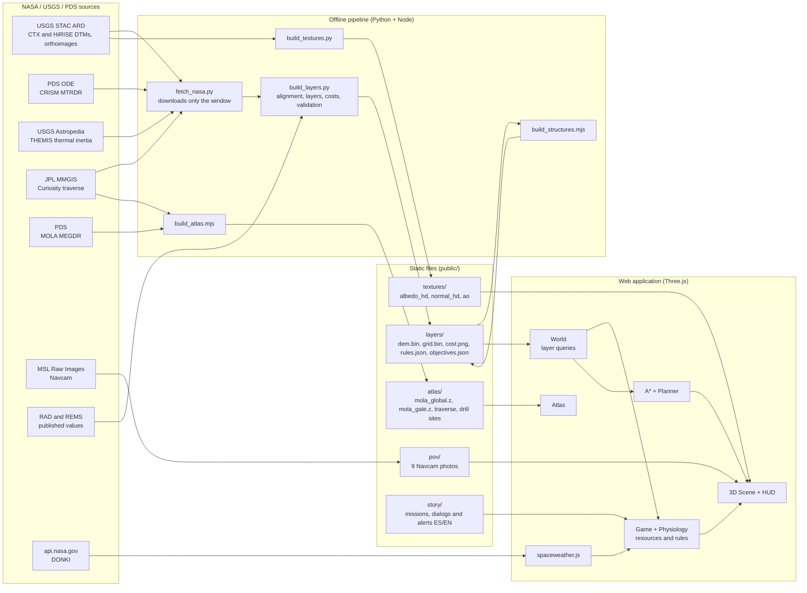

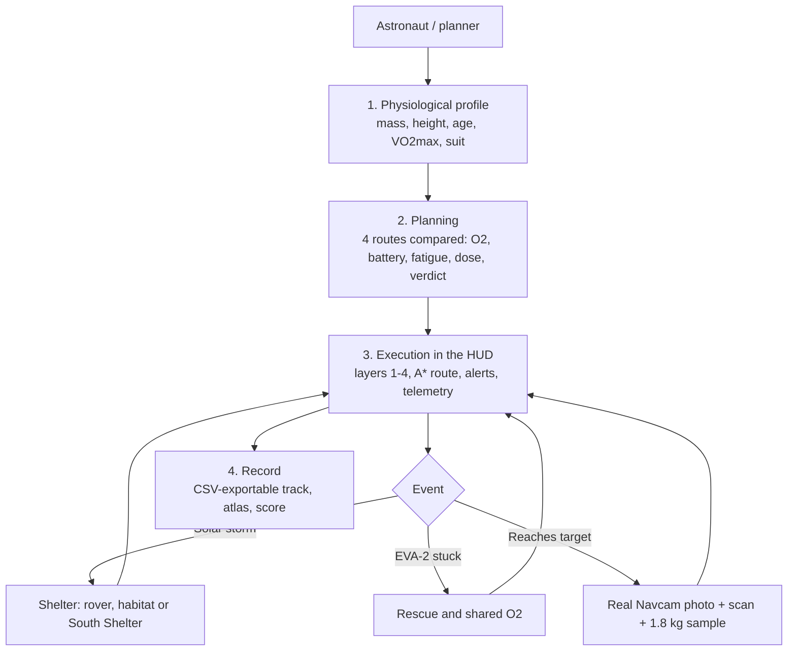

### 6.2 Integrated layers

| Layer (key) | Data type | Source | Resolution on the map | Derived rule | Thresholds |
|---|---|---|---|---|---|
| Slope (1) | Topographic | CTX + HiRISE DTM | 6 m | Speed and O₂; suit wear; blocking | safe < 12° · slip 18–25° · blocked > 25° |
| Roughness (drawn in layer 1) | Derived topographic | HiRISE DTM (3 m) | 6 m | Terrain coefficient and boulders that cannot be stepped on | rocky > 0.6 m · boulder field > 0.9 m |
| Radiation (2) | Radiation | RAD + sky view + altitude | 6 m | Suit integrity loss; ×40 during a storm | safe < 8.3 · danger > 8.7 µGy/h |
| Temperature (3) | Thermal | REMS + THEMIS + orientation | 6 m (100 m THEMIS resampled) | Battery use | safe > −25 °C · danger < −45 °C |
| Minerals (4) | Spectral | CRISM (7 products) | 6 m (18 m CRISM) | Target placement; terrain coefficient | classes 0–4 |
| Optical / texture | Optical | CTX 20 m + HiRISE 1 m | 1.5 m/px | Visual context | — |
| Suggested route (R) | Combination | `cost.png` | 12 m (A*) | Safest path, not the shortest | 0 = impassable |
| Atlas (M) | Global topographic and atmospheric | MOLA | ~7.4 km and ~925 m | Pressure, air column, liquid water | P > 611.7 Pa |
| Space weather | Radiation (heliophysics) | DONKI | — | Risk level and warning text | high, moderate, low |

### 6.3 Validation results (from `data/processed/report.json`)

| Indicator | Result |
|---|---|
| DEM vs. 857 Curiosity stops | median **+0.1 m**, MAD **2.17 m**, 95th percentile of absolute error **10.85 m** |
| Slope at Curiosity's stops | median 8.6°, p95 **21.2°**; only 3.4% fall on cells we mark as blocked |
| Blocked area (> 25°) | 11.6% of the crop |
| Area reachable from the habitat | 86.1%; **all 7 key points are reachable** |
| CRISM clays within the Glen Torridon elevation band | **96.1%** |
| CRISM sulfates above −4,078 m (sulfate unit) | **96.7%** |
| Mineral classes in the crop | clays 2.7% · sulfates 29.1% · basaltic sand 4.6% |
| THEMIS thermal inertia | 301–528 TIU (median 403), consistent with Fergason et al. (2012) |
| Roughness | 20.2% of the map rocky and 8.8% boulder field; only 12.3% of Curiosity's stops are on rocky terrain |
| Crop elevation | −4,330 m to −3,057 m (~1,270 m of relief) |
| Modeled radiation | 4.3–9.4 µGy/h (median 8.5) |
| Modeled ground temperature | 10:00 median −25 °C · night median −86 °C |
| MOLA vs. Curiosity at the landing site | −4,505 m vs. −4,501 m |

> *Note for Sunday's verification:* `docs/fuentes.md` and `docs/reglas.md` quote an earlier validation run (median −0.25 m, MAD 2.0 m). This document uses the values in `report.json`, the file the pipeline generates. Those two documents need to be updated to match.

### 6.4 Science targets on real Curiosity stops

| Point | Type | Curiosity sol | Slope | CRISM class | Science |
|---|---|---|---|---|---|
| Aeolis Habitat | Base / shelter | 2320 | 7.1° | — | Start, entrance to Glen Torridon |
| Clay-bearing unit | Target 1 | 2481 | 7.7° | Clays | Phyllosilicates formed in near-neutral-pH water (*Glen Etive* drill hole) |
| Support rover Tumbo | Shelter | 3489 | 17.2° | Sulfates | Partial recharge (up to 60%) |
| Sulfate-bearing unit | Target 2 | 3608 | 6.2° | Sulfates | Record of the drying climate (*Canaima* drill hole) |
| Gediz Vallis sulfur stones | Target 3 | 4200 | 7.7° | Sulfates | Nearly pure elemental sulfur (2024) |
| South Shelter | Shelter / end | 4558 | 5.5° | Boxwork | Pressurized module |
| Boxwork formations | Target 4 | 4671 | 9.0° | Boxwork | Groundwater that cemented fractures |

### 6.5 Features verified at the end of Saturday
- `npm run build` compiles without errors (Vite 7.1.12; 33 modules; 807 kB JS bundle, 234 kB gzipped).
- On the development server the game loads the physiological profile screen with its derived calculations (for example, for the reference profile: 504 N of weight on Mars and 8.0 h of O₂ endurance walking on flat ground).
- **Automated end-to-end test** (`docs/prueba_completa.md`): a bot plays using the game's own logic, follows A*, scans, shelters from the storm and rescues EVA-2.

| Profile | Result | Real time | Recharges | Points |
|---|---|---|---|---|
| Reference (75 kg, 175 cm, VO₂max 45) | ✅ 5/5 missions | 21.9 min | 1 | 1129 |
| 56 kg · 160 cm | ✅ | 23.4 min | 1 | 1079 |
| 92 kg · 190 cm | ✅ | 22.1 min | 1 | 1127 |
| VO₂max 28 | ✅ | 27.8 min | 1 | 1034 |
| Apollo A7LB suit (91 kg) | ❌ out of O₂ in mission 4 | 45.4 min | 3 | — |
| xEMU suit (145 kg) | ❌ out of O₂ in mission 3 | 27.4 min | 3 | — |

  One operational finding from this test: **the straight line is usually impassable** (slopes > 25°) and the safe route is ~18% longer.
- Content: 5 missions, 21 alerts, dialogs and fun facts in ES/EN; 34 data-placed structures (13 drill sites, 6 relays, 5 depots, 3 weather stations, landing pad, solar farm, O₂ ISRU plant, greenhouse, seismometer and Curiosity); an atlas with 40 features, 10 natural phenomena with protective measures, Curiosity's full traverse and 22 drill sites.

### 6.6 Visual evidence

> Screenshots taken on November 14, 2026 from the local build of commit `efd3576` (Chrome, 1540×788). To reach each situation quickly we used `?debug=1` mode and the game's debug console (teleporting, forcing the storm); every value, layer, photo and text shown is computed and displayed by the game itself.

<figure>
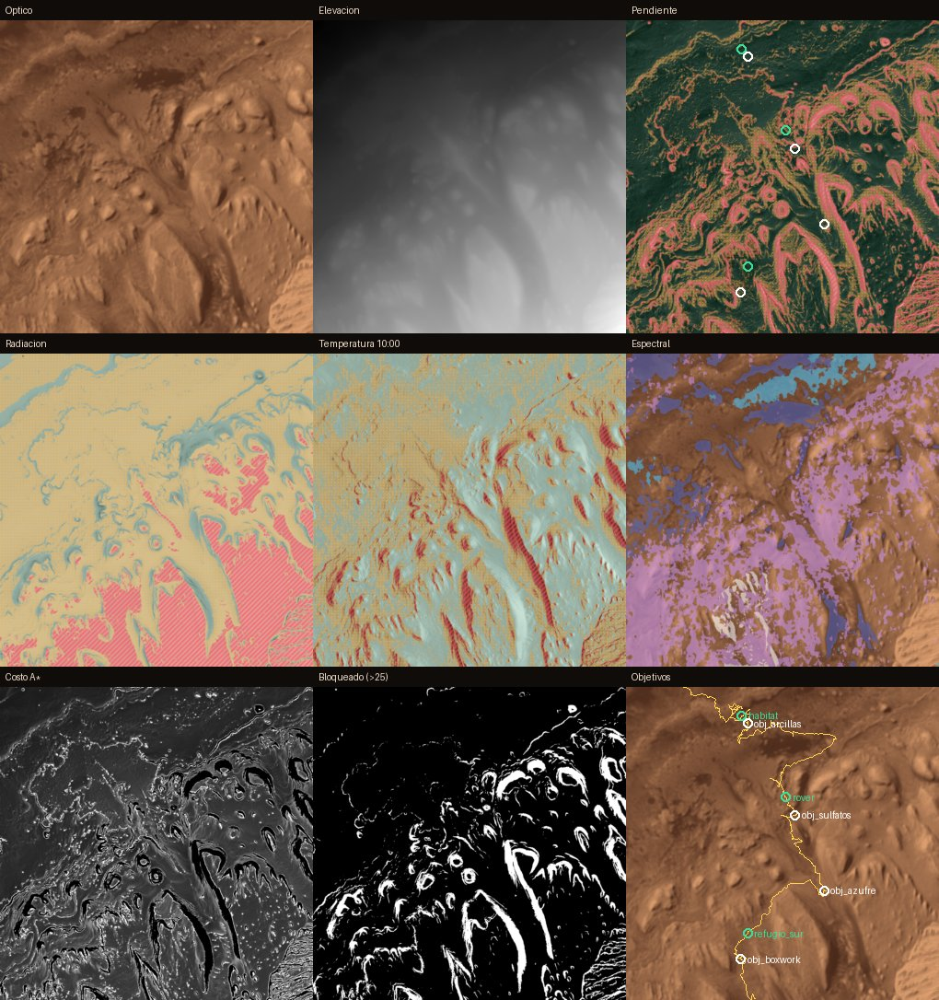
<figcaption>Figure 1. Preview generated by the pipeline (<code>data/processed/preview.png</code>): orthoimage, DEM, slope, radiation, temperature and minerals of the 6.1 × 6.1 km crop.</figcaption>
</figure>


<figure>
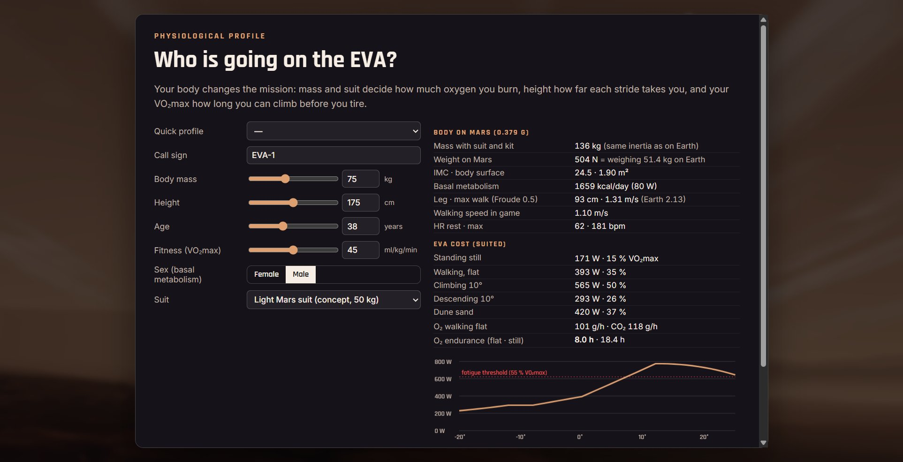
<figcaption>Figure 2. Physiological profile with the reference astronaut (75 kg, 175 cm, VO₂max 45, 50 kg suit): weight on Mars, metabolism, cost vs. slope and O₂ endurance.</figcaption>
</figure>


<figure>
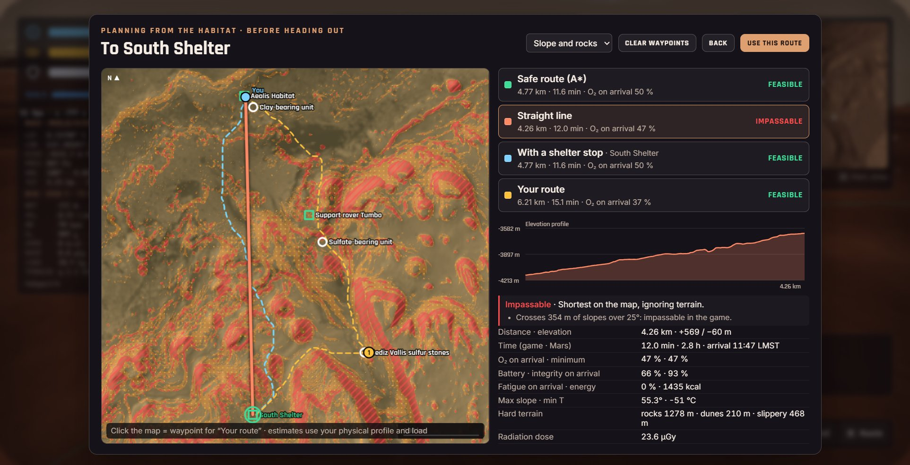
<figcaption>Figure 3. EVA planning from Aeolis Habitat to the South Shelter. The straight line (selected) is <strong>impassable</strong>: it crosses 354 m of slopes &gt; 25°. The A* route (4.77 km, O₂ on arrival 50%) and the custom route with a waypoint at Gediz Vallis (6.21 km, 37%) are feasible.</figcaption>
</figure>


<figure>
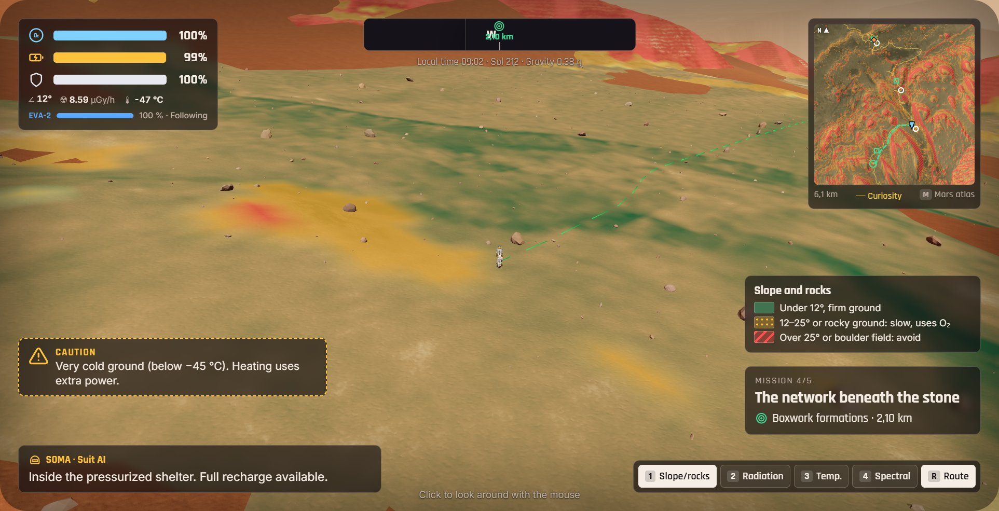
<figcaption>Figure 4. HUD on the 3D terrain with layer 1 (Slope and rocks): green &lt; 12°, dots 12–25°, stripes &gt; 25°. The dashed green line is the A* route; the minimap shows Curiosity's traverse.</figcaption>
</figure>


<figure>
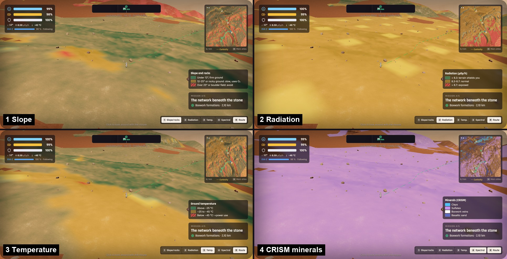
<figcaption>Figure 5. The same view with the four layers: 1 Slope, 2 Radiation, 3 Temperature and 4 CRISM minerals (lilac = sulfates).</figcaption>
</figure>


<figure>
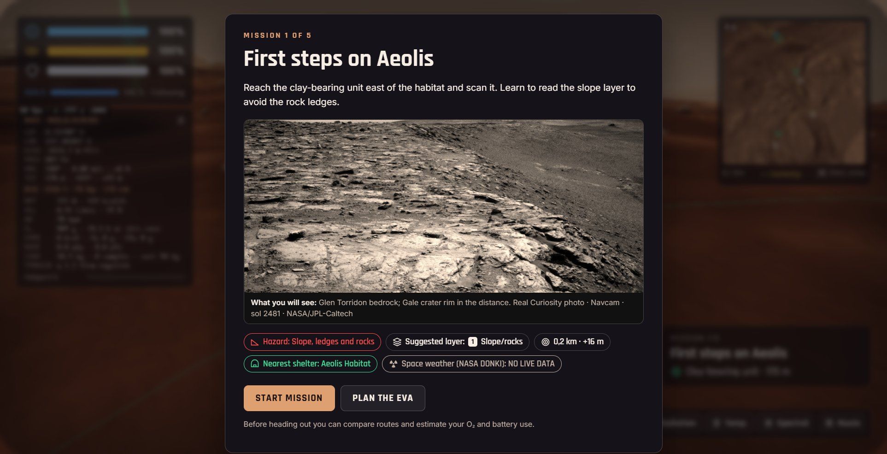
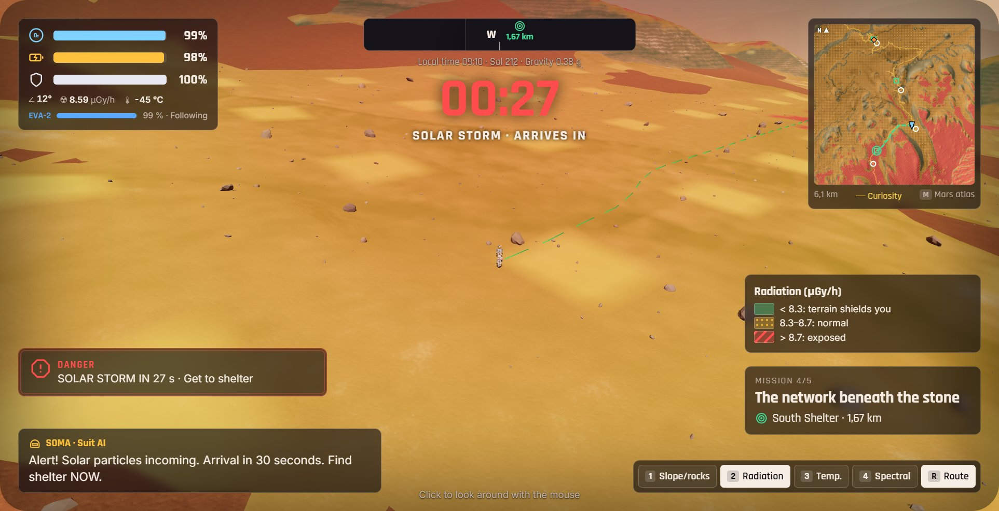
<figcaption>Figure 6. Top: mission card with the arrival Navcam photo and the NASA DONKI space-weather chip; during the capture the API returned 429 and the chip shows “NO LIVE DATA”. Bottom: solar-storm alert with countdown, radiation layer switched on and the real May 2024 reference event.</figcaption>
</figure>


<figure>
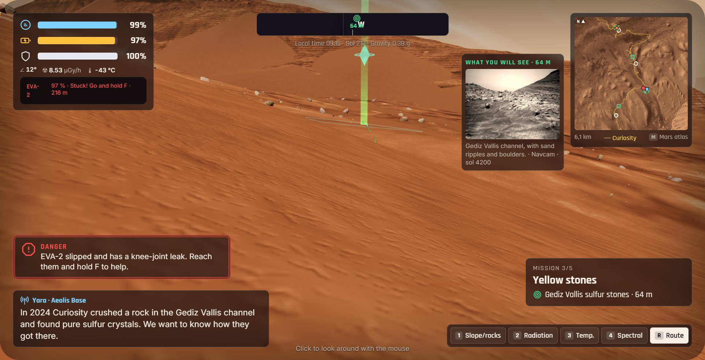
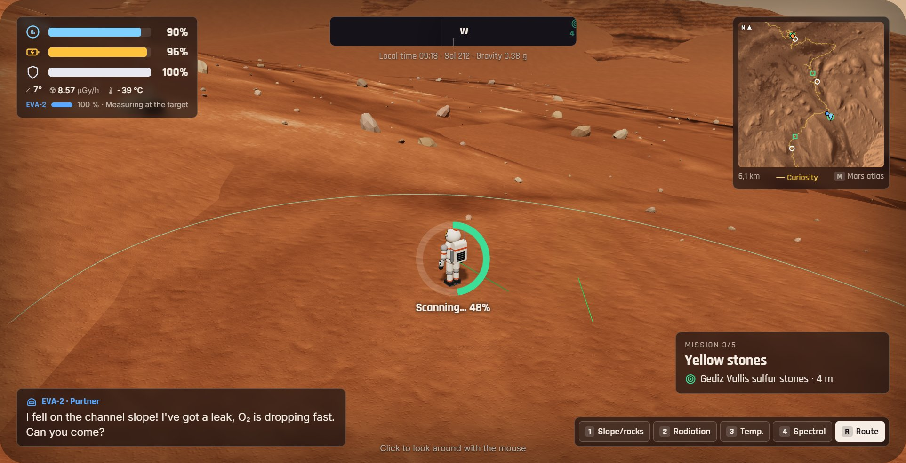
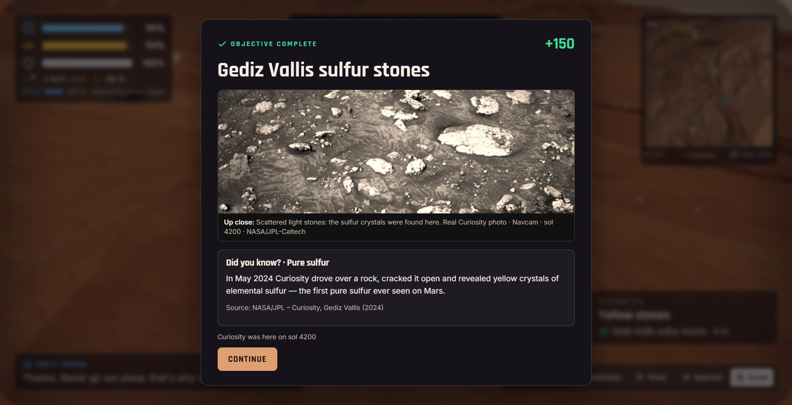
<figcaption>Figure 7. Gediz Vallis sulfur stones (sol 4200): “On arrival you'll see” inset with the real Navcam photo at 64 m, scan in progress inside the target radius, and the science card with the close-up photo and the NASA/JPL source.</figcaption>
</figure>


<figure>
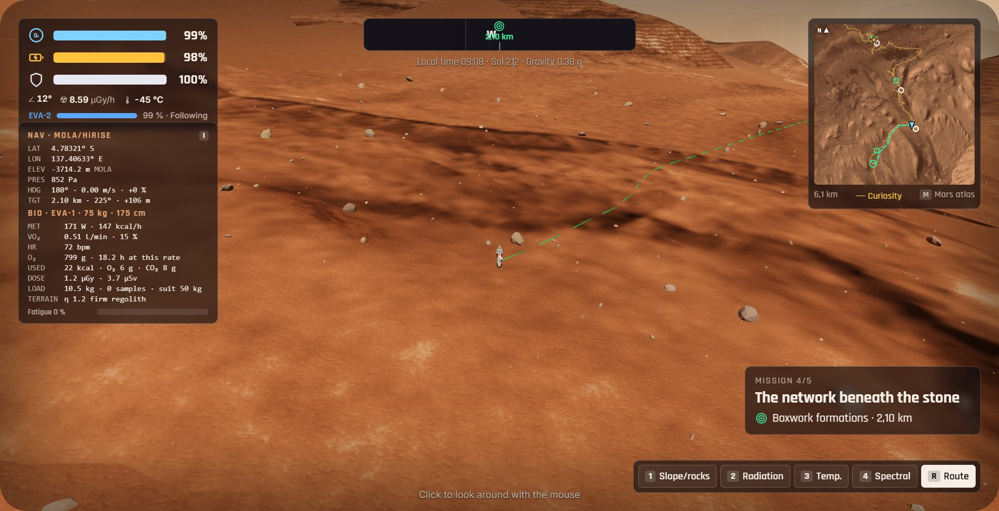
<figcaption>Figure 8. NAV/BIO telemetry (I key): latitude/longitude, elevation, pressure, heading, distance to target, metabolic power, VO₂, heart rate, remaining O₂, dose and load.</figcaption>
</figure>


<figure>
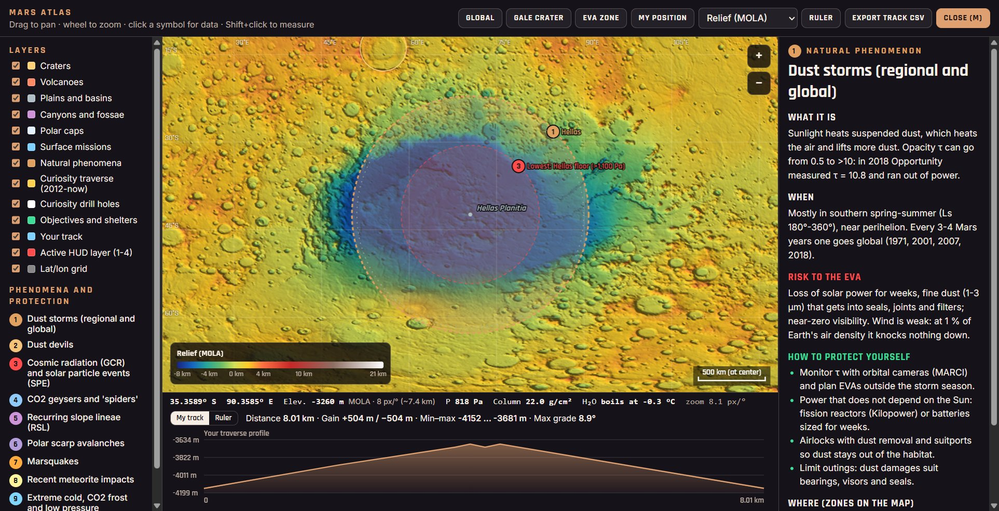
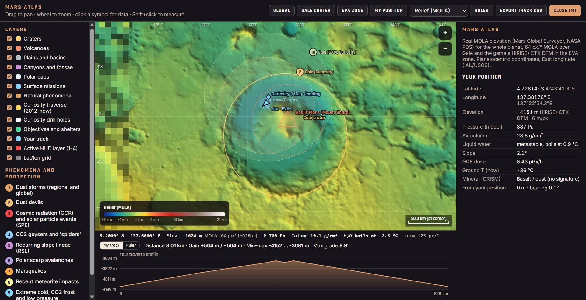
<figcaption>Figure 9. Mars atlas (M key). Top: global level with MOLA relief and the “Dust storms” phenomenon with its risk and protective measures. Bottom: Gale crater level (MOLA 64 px/°) with Curiosity's landing site and the EVA zone.</figcaption>
</figure>


<figure>
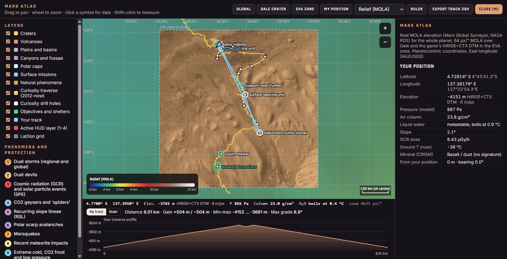
<figcaption>Figure 10. Atlas at the EVA-zone level (HiRISE + CTX DTM, 6 m/px) with Curiosity's traverse, targets, shelters, the user's own track, its elevation profile and the “Export track CSV” button. <em>The user's track shows straight segments because debug shortcuts were used to move between targets during the capture.</em></figcaption>
</figure>


<figure>
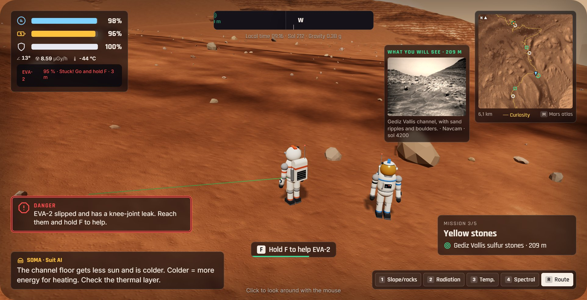
<figcaption>Figure 11. EVA-2 stuck in Gediz Vallis: danger alert, partner status (O₂ 87%) and the assist bar while F is held.</figcaption>
</figure>


<figure>
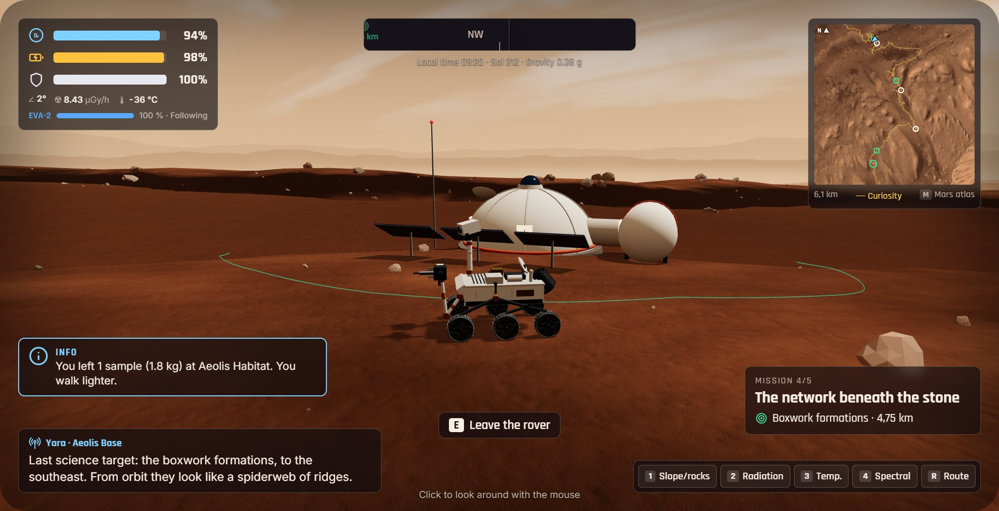
<figcaption>Figure 12. Drivable support rover (E key) in front of Aeolis Habitat and the solar farm; on arrival the samples (1.8 kg) are unloaded and the load drops.</figcaption>
</figure>


<figure>
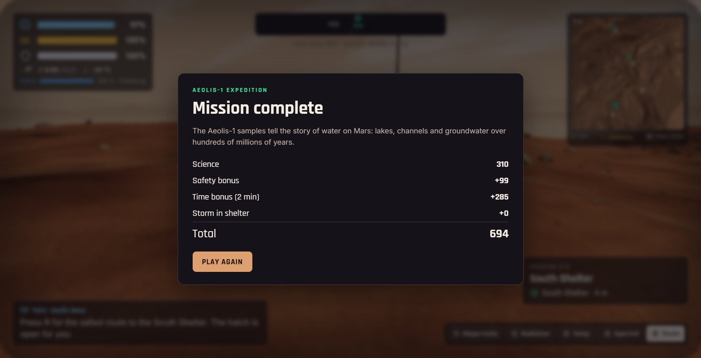
<figcaption>Figure 13. Campaign end screen with the score breakdown (science, safety, time, storm). <em>The score comes from the capture session with debug shortcuts, not from a full playthrough.</em></figcaption>
</figure>


### 6.7 Public links

- **Playable demo:** [COMPLETAR ENLACE PÚBLICO: Demo]
- **GitHub repository:** [COMPLETAR ENLACE PÚBLICO: Repositorio GitHub — current remote `https://github.com/Andresmejia62/Pimpollos`; confirm it is public]
- **Interactive prototype / HUD wireframes:** [COMPLETAR ENLACE PÚBLICO: Prototipo interactivo]
- **Video (English, 30 s):** [COMPLETAR ENLACE PÚBLICO: Video]

### 6.8 How to reproduce
```bash
cd mars-survival-map
npm install
npm run dev          # http://127.0.0.1:5173  (?debug=1 for FPS and shortcuts)
npm run build        # static site in dist/
```
Regenerate the data (requires Python 3, numpy, Pillow and rasterio):
```bash
python3 data/scripts/fetch_nasa.py
python3 data/scripts/build_layers.py
python3 data/scripts/build_textures.py
node data/scripts/build_atlas.mjs
NASA_API_KEY=<key> node data/scripts/fetch_donki.mjs
```

---

## 7. Impact and outlook

### 7.1 Beneficiaries
**Direct**
- **Astronauts and surface crews:** a tactical map that turns data into decisions (which way to go, what it costs, where to shelter) and that can be consulted in the habitat before leaving or as a HUD during the EVA.
- **Mission planners:** quantitative comparison of routes according to each crew member's physiology and suit, and early detection of profiles or suits that cannot complete the traverse (in the test, the heavy suits).
- **Planetary researchers:** an open, reproducible pipeline that aligns orbital DTMs with rover measurements and produces validated layers for any crop.

**Indirect**
- **Education:** the student does not read that clays indicate water; they decide to walk to them and find out. It runs in the browser, in Spanish and English.
- **Science outreach:** it puts Curiosity, MRO and Odyssey data in the public's hands in a format people understand.
- **Analog simulation:** a basis for EVA rehearsals at analog stations and for studying decision-making under communication delay.

### 7.2 Applications in crewed missions and real scope
- **Traverse rehearsal** before an EVA, with each crew member's real profile and the load of tools and samples.
- **Site selection** for infrastructure: the pipeline already places the landing pad on the flattest ground within 170 m of the habitat and the relays on high points.
- **Safety protocols:** shelters against solar storms, the *buddy system* and use of the rover as a mobile shelter and sample carrier.
- **Scalability:** the crop is defined in `region.json`; the same scripts can generate another area of Mars that has HiRISE, CTX and CRISM coverage.

**Current limits (honest scope).** This is a hackathon prototype, not a certified tool:
- Radiation and temperature are models calibrated with point measurements, not measured maps.
- The exact position of each individual boulder is random; their abundance does come from the DTM.
- The Pandolf metabolic model was validated on Earth, and its corrections for reduced gravity and the suit are approximate.
- Game time is compressed ×14.
- There are no usability tests with people yet.

### 7.3 Roadmap
**Sunday, November 15, morning (Blocks 05 and 06)**
1. Change the application's visible title from "Mars Survival Map" to **Marsift** (`index.html`, start screen and credits).
2. Save a DONKI snapshot with the team's own api.nasa.gov key (`fetch_donki.mjs` → `public/spaceweather/donki.json`), or set `VITE_NASA_API_KEY` in the deployment, so space weather shows real data.
3. Align the validation figures in `docs/fuentes.md` and `docs/reglas.md` with `report.json`.
4. Publish the demo as a static site and check the public links.
5. Run the quick usability tests (`docs/pruebas_usabilidad.md`) if time allows, take the screenshots listed in section 6.6 and record the 30-second English video.

**After the hackathon**
- Integrate the USGS-NASA Planetary Geologic Mapping Program maps and JPL Mars Trek layers as additional sources.
- Add a Jezero crater crop with Perseverance imagery.
- Compute cast shadows and hourly illumination.
- Radiation maps based on particle-transport models.
- A tablet or visor HUD mode and a multiplayer mode for the crew.
- Validation of the physiological model with EVA analog data.

---

## 8. References and tools used

### 8.1 Scientific sources and datasets
- USGS Astrogeology — Analysis Ready Data, STAC catalog (CTX and HiRISE DTMs and orthoimages): https://stac.astrogeology.usgs.gov/api
- MRO HiRISE (University of Arizona / NASA): https://www.uahirise.org
- MRO CTX (Malin Space Science Systems / NASA): https://www.msss.com/all_projects/mro-ctx.php
- PDS Geosciences Node — CRISM MTRDR and MOLA MEGDR: https://pds-geosciences.wustl.edu · ODE REST: https://oderest.rsl.wustl.edu
- THEMIS Global Thermal Inertia Mosaic (USGS/ASU): https://astrogeology.usgs.gov/search/map/themis_thermal_inertia_mosaic_quantitative_30s120e_100mpp
- NASA/JPL MMGIS — MSL waypoints: https://mars.nasa.gov/mmgis-maps/MSL/Layers/json/MSL_waypoints.json
- MSL Raw Images (Curiosity): https://mars.nasa.gov/msl/multimedia/raw-images/
- NASA DONKI (CCMC/GSFC) via https://api.nasa.gov
- USGS Gazetteer of Planetary Nomenclature: https://planetarynames.wr.usgs.gov
- NASA Mars Fact Sheet: https://nssdc.gsfc.nasa.gov/planetary/factsheet/marsfact.html
- Hassler, D. M. et al. (2014). Mars' surface radiation environment measured with the Mars Science Laboratory's Curiosity rover. *Science* 343, 1244797. doi:10.1126/science.1244797
- Viviano-Beck, C. E. et al. (2014). Revised CRISM spectral parameters and summary products. *JGR Planets* 119, 1403–1431.
- Fergason, R. L. et al. (2012). Surface properties of the Mars Science Laboratory candidate landing sites: Characterization from orbit and predictions. *Space Science Reviews* 170.
- Siebach, K. L. and Grotzinger, J. P. (2014). Volumetric estimates of ancient water on Mount Sharp based on boxwork deposits. *JGR Planets* 119.
- Pandolf, K. B. et al. (1977). Predicting energy expenditure with loads while standing or walking very slowly. *Journal of Applied Physiology* 43.
- Norcross, J. R. et al. (2010). *Metabolic costs and biomechanics of level ambulation in a planetary suit*. NASA/TP-2010-216139.
- Mifflin, M. D. et al. (1990); DuBois and DuBois (1916); Tanaka et al. (2001); Swain and Leutholtz (1997); Farley and McMahon (1992); Kram et al. (1997): equations of the physiological model (`docs/fisiologia.md`).
- Allison, M. and McEwen, M. (2000). A post-Pathfinder evaluation of areocentric solar coordinates (Mars24 algorithm, NASA GISS).
- Standish, E. M. — *Approximate Positions of the Planets*, JPL Solar System Dynamics.
- NASA/JPL: Curiosity releases on Glen Torridon, the Gediz Vallis sulfur (2024), the boxwork region (2025) and the solar storm observed at Mars in May 2024.

### 8.2 Detected technology stack

| Layer | Technologies |
|---|---|
| Languages | JavaScript (ES2022, ES modules), Python 3, HTML5, CSS3, GLSL (Three.js shaders) |
| 3D visualization | Three.js 0.180.0 (WebGL) |
| Build and dev server | Vite 7.1.12, Node.js, npm |
| Geospatial processing | rasterio / GDAL (cloud-optimized GeoTIFFs, windowed reads and reprojection), NumPy, Pillow |
| Data protocols | STAC API, PDS ODE REST, HTTP Range (MOLA), REST (api.nasa.gov) |
| Browser APIs | WebGL, `DecompressionStream`, Fetch, Web Audio, `localStorage` (DONKI cache) |
| Design and documentation | Interactive HTML wireframes, Markdown, Mermaid, Obsidian (notes), JetBrains IDE (`.idea`) |
| Version control | Git and GitHub |
| Planned publishing | Static site (GitHub Pages or Netlify) |

### 8.3 Artificial Intelligence use statement
Team Pimpollos states that it used artificial intelligence tools during the development of Marsift and the preparation of this documentation:

- **Claude (Anthropic), including Claude Code:** used as an assistant to write part of the data-pipeline and web-engine code, to draft texts (story, dialogs, technical documentation) and the wireframes, and to **audit the repository and structure and write this document** in Spanish and English from the project's real code, data and history.
- **Other AI tools:** [COMPLETAR: list any other AI tools the team used, or write "None"].

The team reviewed, corrected and validated all AI-assisted content. The figures in this document were taken from the files the pipeline generates (`data/processed/report.json`, `data/raw/manifest.json`) and from the repository's technical documentation. **The project's images, textures and elevation models are real NASA and USGS data, not AI-generated images.**
