# Marsift — Documentación de la propuesta

**NASA Space Apps Challenge · Sede Managua 2026 (14–15 de noviembre de 2026)**  
**Reto:** Interplanetary Survival Guide: Martian Map · **Nivel:** Intermediate · **Temas:** Human Exploration, Mars, Planets & Moons, Software, Space Exploration  
**Equipo:** Pimpollos · **Versión del documento:** cierre del Día 1 (sábado 14 de noviembre de 2026, 11:59 p. m.), basada en el commit `efd3576` del repositorio

> **Nota de nombre.** *Marsift* es el nombre oficial de la propuesta. En el código y en la interfaz actual el proyecto todavía aparece con su nombre de trabajo, **"Mars Survival Map"** (carpeta `mars-survival-map/`, título de la página y `package.json`). Cambiar ese título en la interfaz es una de las tareas del domingo (ver apartado 7.3).

---

## 1. Identificación del proyecto

| Campo | Valor |
|---|---|
| **Nombre de la propuesta** | Marsift |
| **Nombre del equipo** | Pimpollos |
| **Integrantes** | Raúl Valverde, Erick Arana, Andres Mejia, Jesser Rodriguez |
| **Reto oficial elegido** | Interplanetary Survival Guide: Martian Map |
| **Sede y fecha** | NASA Space Apps Challenge Managua 2026 (14–15 de noviembre de 2026) |

**Identificación de la solución.** Marsift es un **mapa táctico 3D, web e interactivo, para planificar y ejecutar una caminata marciana (*Marswalk*)** en una zona de 6,1 × 6,1 km de la ladera norte del **Monte Sharp (cráter Gale)**, la misma que recorre el rover Curiosity. Reúne en una sola cuadrícula de 6 m/píxel el relieve de alta resolución (DTM de HiRISE y CTX), la mineralogía (CRISM), la inercia térmica (THEMIS), la radiación y la temperatura medidas en superficie (RAD y REMS) y la traza real del rover. Con esos datos estima por dónde se puede caminar, cuánto oxígeno, energía y dosis cuesta cada ruta para un astronauta concreto, y dónde refugiarse. La interfaz funciona como un HUD de casco en primera/tercera persona, con un modo de planificación previo a la salida y un atlas de todo Marte. Corre en el navegador sin instalación.

---

## 2. Resumen de la propuesta

**Qué desarrollamos.** Un simulador y planificador de EVA en el navegador (Three.js + Vite) alimentado por un *pipeline* de datos reproducible en Python y Node.js. El pipeline descarga solo la ventana necesaria de productos públicos de NASA/USGS/PDS, los alinea con las elevaciones que midió Curiosity y genera las capas que usa el mapa 3D.

**Qué problema aborda.** Los mapas de Marte que existen hoy son globales o regionales y están pensados para orbitadores y rovers. Un astronauta a pie necesita saber a escala de metros qué pendientes no puede subir con el traje, dónde hay campos de bloques, qué tan frío está el suelo, dónde está más protegido de la radiación, hasta dónde le alcanza el oxígeno y dónde está el refugio más cercano si llega una tormenta solar.

**Cómo responde al reto.**
1. **Ubicación y objetivo científico:** Monte Sharp, de Glen Torridon a la región *boxwork*. Los cuatro objetivos son "capítulos de la historia del agua" que Curiosity confirmó: arcillas (lagos antiguos), sulfatos (secado del clima), piedras de azufre de Gediz Vallis (canales) y *boxwork* (agua subterránea). Cada objetivo está sobre una parada real del rover.
2. **Integración multicapa:** combina siete tipos de dato: topográfico, óptico, espectral, térmico, de radiación, atmosférico y de trayectoria del rover (tabla 6.2).
3. **Seguridad y movilidad:** pendientes > 25° bloqueadas, rugosidad y campos de bloques, ruta A* sobre un mapa de costos que combina todas las capas, planificación con estimación de O₂, batería, fatiga y dosis según el perfil fisiológico y el traje, refugios ante tormentas solares, compañero de EVA (*buddy system*), rover de apoyo y fotos reales de Curiosity en primera persona.

**Principal resultado técnico logrado.** Un terreno 3D real cuyo modelo de elevación, comparado con **857 paradas de Curiosity**, tiene una **diferencia mediana de 0,1 m y una dispersión robusta (MAD) de 2,2 m**. Sobre él funciona una campaña jugable de 5 misiones que una prueba automática completó de principio a fin con 4 perfiles de astronauta (apartado 6).

---

## 3. Problema y objetivos

### 3.1 Contexto y necesidad operacional
La NASA explora Marte con robots desde hace décadas. Sus datos son públicos, pero están repartidos en productos distintos (modelos de elevación, imágenes, espectros, mediciones de superficie), cada uno con su proyección, su resolución y su formato. Herramientas como *JPL Mars Trek* o los mapas del *USGS-NASA Planetary Geologic Mapping Program* sirven para la vista global o regional. Ninguna está organizada para responder las preguntas tácticas de una persona que va a caminar 7 km con un traje presurizado:

- ¿Puedo subir esa ladera con el traje y el equipo que llevo?
- ¿Me alcanza el oxígeno para ir, muestrear y volver por esta ruta?
- Si el Sol lanza una tormenta de partículas, ¿a cuánto está el refugio?
- ¿Dónde está exactamente la roca que quiero muestrear y qué voy a ver al llegar?

Tras el sobrevuelo lunar de Artemis II y la planificación de una base lunar, la siguiente frontera son las caminatas en Marte. Con un retraso de comunicación con la Tierra de varios minutos (14 min en la narrativa del juego), la tripulación tendrá que decidir sola, con datos, en el lugar.

### 3.2 Pregunta que motiva a Marsift
> ¿Se pueden integrar productos orbitales y mediciones de superficie de la NASA en un solo mapa a escala de metros, validado contra datos de un rover, que traduzca cada capa en una consecuencia concreta para la seguridad y la productividad científica de un astronauta?

### 3.3 Objetivo general
Construir un mapa táctico interactivo de una zona real de Marte que integre al menos tres tipos de datos de NASA y que permita **planificar, ensayar y ejecutar** una caminata segura y científicamente productiva.

### 3.4 Objetivos específicos y estado al cierre del sábado

| # | Objetivo específico | Estado |
|---|---|---|
| O1 | Elegir una zona con objetivos científicos confirmados y recortarla en una cuadrícula común | ✅ Hecho: 6,144 km de lado, 1024×1024 px a 6 m/px, centrada en 4,770° S, 137,395° E |
| O2 | Construir un modelo de elevación preciso y validarlo contra mediciones de superficie | ✅ Hecho: CTX + 3 DTM de HiRISE, validado con 857 paradas de Curiosity |
| O3 | Integrar 3 o más capas de datos y documentar el método de cada una | ✅ Hecho: 7 tipos de dato (tabla 6.2) |
| O4 | Traducir cada capa en reglas de seguridad y consumo de recursos con umbrales justificados | ✅ Hecho: `rules.json` + `docs/reglas.md` |
| O5 | Calcular rutas seguras y estimar su costo antes de salir | ✅ Hecho: A* + vista de planificación de la EVA |
| O6 | Modelar al astronauta (masa, estatura, edad, VO₂max, traje) | ✅ Hecho: modelo de Pandolf adaptado a 0,379 g |
| O7 | Dar contexto visual en primera persona y contexto global | ✅ Hecho: fotos Navcam reales por objetivo y atlas MOLA de todo Marte |
| O8 | Integrar clima espacial en tiempo real | ⚠️ Parcial: código hecho con NASA DONKI; en la prueba del sábado la clave pública `DEMO_KEY` respondió HTTP 429 y no hay copia guardada en el repositorio, así que se usó el evento de referencia de mayo de 2024 |
| O9 | Validar la usabilidad con personas ajenas al equipo | ⏳ Pendiente: el protocolo está escrito (`docs/pruebas_usabilidad.md`), la tabla de resultados está vacía |

---

## 4. Solución desarrollada

### 4.1 Planteamiento funcional
Marsift sigue el ciclo de una EVA real: **perfil → planificación → ejecución → registro**.

1. **Perfil fisiológico** (`src/ui/profile.js`): antes de salir se elige masa, estatura, edad, sexo, VO₂max y traje (traje marciano ligero de 50 kg, Apollo A7LB + PLSS de 91 kg o xEMU de ~145 kg). La pantalla calcula peso en Marte, metabolismo basal, velocidad máxima de marcha (número de Froude), frecuencia cardíaca y autonomía de O₂.
2. **Planificación de la EVA** (`src/ui/planner.js`, `src/gameplay/planner.js`): compara cuatro rutas (A*, línea recta, con escala en un refugio y una propia, con puntos de paso que el usuario marca en el mapa y que se enlazan con A*), con perfil de elevación, distancia, desnivel, pendiente máxima, metros bloqueados, rocosos o con riesgo de resbalar, y estimación de O₂ mínimo, batería, integridad, fatiga y dosis. Cada ruta recibe un veredicto: `ok`, `risky`, `fail` o `blocked`.
3. **Ejecución en el HUD** (`src/ui/hud.js`): terreno 3D, barras de O₂, energía e integridad del traje, minimapa con la traza de Curiosity, brújula, capas 1–4 (pendiente, radiación, temperatura, minerales) dibujadas sobre el terreno, ruta sugerida (R), telemetría NAV/BIO (I) y alertas.
4. **Registro y contexto** (`src/ui/atlas.js`, tecla M): atlas de Marte en tres niveles (global, Gale y zona EVA), traza propia exportable a CSV, regla de distancias y perfiles de elevación.

### 4.2 Arquitectura
El sistema tiene dos partes que se comunican solo por archivos. Así el mapa funciona sin servidor propio y se puede publicar como sitio estático (GitHub Pages o Netlify, `vite.config.js` con `base: "./"`).

**A. Pipeline de datos (fuera de línea)** — `mars-survival-map/data/scripts/`

| Script | Función |
|---|---|
| `fetch_nasa.py` | Consulta el catálogo STAC de USGS Astrogeology y la API ODE del PDS; descarga **solo la ventana del recorte** (≈23–32 MB) de los DTM, ortoimagen CTX, THEMIS y CRISM; guarda la procedencia en `data/raw/manifest.json` |
| `real_data.py`, `layers_lib.py`, `region.py` | Reproyección a la cuadrícula común, alineación vertical con Curiosity, fusión HiRISE/CTX, pendiente, rugosidad, cielo visible, modelos de radiación y temperatura, clasificación CRISM, mapa de costos |
| `build_layers.py` | Genera `public/layers/` (DEM de 16 bits, capas PNG, `grid.bin`, `cost.png`), `data/processed/report.json` (estadísticas, validación y alcanzabilidad de objetivos) y una vista previa |
| `build_textures.py` | Texturas HD: ortoimágenes HiRISE (1 m/px) igualadas a CTX, normales y oclusión ambiental del DTM |
| `build_atlas.mjs` | Descarga MOLA MEGDR por HTTP Range; genera `public/atlas/` (MOLA global y Gale comprimidos, traza y perforaciones de Curiosity) |
| `build_structures.mjs` | Coloca las estructuras de la base según las capas (terreno llano, puntos altos, perforaciones reales) |
| `fetch_donki.mjs` | Guarda una copia de NASA DONKI para usar sin red |
| `synthetic.py` | Terreno sintético alternativo (respaldo de desarrollo) |

**B. Aplicación web (en el navegador)** — `mars-survival-map/src/` (~6 500 líneas de JavaScript)

| Módulo | Función |
|---|---|
| `data.js`, `engine/world.js` | Carga las capas y consulta altura, pendiente, radiación, temperatura, mineral y rugosidad en cualquier punto |
| `engine/scene.js` | Malla 3D de 768×768 vértices desde el DEM real, *shader* que superpone las capas y texturas HiRISE, cielo, rocas, marcadores y ruta |
| `engine/physics.js`, `engine/controls.js`, `engine/astronaut.js` | Gravedad de Marte (3,721 m/s²), colisiones, controles y astronauta |
| `engine/physiology.js` | Gasto metabólico (Pandolf adaptado), VO₂, O₂, CO₂, frecuencia cardíaca, fatiga, carga del equipo y muestras |
| `engine/marsrover.js`, `engine/props.js`, `engine/structures.js` | Rover conducible de 6 ruedas con *rocker-bogie* que sigue el terreno, hábitat, refugios e infraestructura de la base |
| `gameplay/game.js`, `gameplay/alerts.js` | Reglas de `rules.json`: recursos, escaneo, tormenta solar, refugios, puntaje y 21 alertas |
| `gameplay/pathfinding.js` | A* sobre una cuadrícula de 512×512 (celdas de 12 m) con regla estricta de bloqueo |
| `gameplay/planner.js`, `ui/planner.js` | Estimación de rutas antes de salir |
| `gameplay/companion.js` | EVA-2, el compañero de caminata |
| `spaceweather.js` | Pronóstico de clima espacial desde NASA DONKI |
| `marsclock.js`, `engine/planets.js` | Hora local en Gale, Ls, sol de Curiosity, distancia y retraso Tierra–Marte; planetas en el cielo |
| `geo.js` | Lat/lon ↔ mundo 3D, distancias de círculo máximo, presión y estado del agua |
| `ui/*.js`, `i18n.js` | HUD, atlas, perfil, pantallas de carga y pausa; todo en español e inglés |

### 4.3 Decisiones técnicas relevantes
- **Validar contra la superficie, no solo contra la órbita.** Cada DTM se alinea verticalmente con la elevación que midió Curiosity en sus paradas (se quitaron desfases de −18,7 m en CTX y de +7,2, +13,9 y +13,3 m en los tres DTM de HiRISE) antes de fundirlos.
- **Umbrales justificados con el rover.** El bloqueo a 25° se apoya en que el 95 % de las paradas de Curiosity están en pendientes de 21,2° o menos según nuestro DEM.
- **Honestidad sobre lo que es medido y lo que es modelado.** RAD y REMS miden en un solo punto; por eso la radiación y la temperatura son **modelos calibrados** con esos valores (el detalle está en el apartado 5.3). Los bloques individuales se colocan al azar dentro de las zonas rugosas; su abundancia sí sale de los datos. Todo está documentado en `docs/reglas.md`.
- **Descargar solo lo necesario.** El pipeline lee ventanas de GeoTIFF optimizados para la nube y solo 8 de las ~60 bandas de CRISM, así que se reproduce en minutos con pocas decenas de MB.
- **Sin servidor y sin instalación.** Datos binarios compactos (`grid.bin`, `dem.bin`, MOLA en un formato propio `.z` que se descomprime con `DecompressionStream`), una sola dependencia de ejecución (`three@0.180.0`) y publicación estática.
- **Datos en tiempo real con degradación ordenada.** El clima espacial usa DONKI en vivo → copia guardada → evento real de referencia, para que el mapa nunca quede sin información.
- **Un solo contrato de coordenadas.** Planetocéntricas, longitud Este 0–360° (convención IAU/USGS), esfera R = 3 396 190 m, definido en `region.json` y usado por el pipeline y el motor.

### 4.4 Aporte innovador
1. **Del dato a la consecuencia.** Cada capa de NASA se convierte en una regla explícita (pendiente → velocidad y O₂; frío → batería; radiación → integridad del traje; minerales → objetivos científicos), y el usuario siente el efecto en vez de leer una leyenda.
2. **Planificación personalizada por fisiología.** La misma ruta cuesta distinto a un astronauta de 56 kg que a uno de 92 kg, o con un traje Apollo frente a uno ligero. Marsift lo calcula antes de salir.
3. **Validación cuantitativa abierta.** El DEM, los minerales y los umbrales están comparados con lo que Curiosity midió en el terreno, y los números están en `report.json`.
4. **Multiescala en una sola herramienta:** de todo Marte (MOLA, ~7,4 km/px) al cráter Gale (~925 m/px), a la zona EVA (6 m/px) y a la textura del suelo (HiRISE, 1,5 m/px), con la misma proyección.
5. **Seguridad operacional realista:** *buddy system* con rescate y "buddy breathing", refugios ante tormentas solares calibradas con la de mayo de 2024 y rover para cargar herramientas y muestras.

---

## 5. Metodología y recursos científicos

### 5.1 Proceso de trabajo
El equipo se organizó en cuatro roles con contratos de archivos entre ellos (`mars-survival-map/README.md`, sección "Contratos entre miembros"):

| Rol | Responsabilidad |
|---|---|
| M1 | Terreno y modelos 3D |
| M2 | Motor web (Three.js), HUD, física y jugabilidad |
| M3 | Datos: recorte, descarga, capas, reglas, objetivos y validación |
| M4 | Historia, misiones, diálogos, wireframes del HUD, guion del video y pruebas de usabilidad |

El desarrollo tuvo 11 commits entre las 11:50 a. m. y las 7:23 p. m. del sábado 14 de noviembre. Pasos metodológicos:
1. **Elegir el recorte sobre la traza de Curiosity** para que cada objetivo tenga verdad de terreno (sol 2481 → sol 4671).
2. **Diseñar con wireframes** (7 pantallas del HUD, `docs/wireframes/index.html`) y un sistema visual con código de peligro que no depende solo del color: liso = seguro, puntos = precaución, rayas = peligro (`docs/sistema_visual.md`).
3. **Construir y validar las capas** con estadísticas automáticas (`report.json`), incluida la comprobación de que **todos los objetivos son alcanzables** desde el hábitat.
4. **Fijar reglas en un archivo único** (`rules.json`) que el motor implementa sin cambios.
5. **Probar de principio a fin con un bot** que juega la campaña con la misma lógica del juego (`docs/prueba_completa.md`).

### 5.2 Datos y recursos científicos utilizados

| # | Recurso | Misión / instrumento | Tipo de dato | Uso en Marsift | Acceso |
|---|---|---|---|---|---|
| 1 | DTM CTX controlado, ajustado al geoide (`T01_000815_1749_XN_05S222W__P21_009149_1752_XI_04S222W`) | MRO / CTX | Topográfico (20 m) | Relieve base (100 % del recorte) | USGS Astrogeology ARD (STAC) |
| 2 | Ortoimagen CTX del mismo par | MRO / CTX | Óptico (20 m) | Textura base y relleno | USGS Astrogeology ARD |
| 3 | 3 DTM HiRISE SOCET SET (`DTEEC_009149_1750_009294_1750_U01`, `DTEEC_019698_1750_019988_1750_U01`, `DTEEC_009650_1755_009716_1755_U01`) | MRO / HiRISE | Topográfico (1 m, leído a 3 m) | Detalle del relieve (cobertura 81 %, 55 % y 28 %), pendiente y rugosidad | USGS Astrogeology ARD (STAC) |
| 4 | Ortoimágenes HiRISE RED de esos pares (`PSP_009149_1750`, `ESP_019698_1750`, `PSP_009650_1755`) | MRO / HiRISE | Óptico (1 m) | Textura HD del suelo (4096², 1,5 m/px) | USGS Astrogeology |
| 5 | 7 productos CRISM MTRDR (FRT000058A3, FRT0000B6F1, HRL0000BABA, FRT00021C92, FRT0001BBA1, FRT0001CA91, FRT0000C518) | MRO / CRISM | Espectral (18 m) | Mapa de minerales: arcillas, sulfatos, arena basáltica | PDS Geosciences Node (API ODE) |
| 6 | Mosaico cuantitativo de inercia térmica THEMIS 30S120E | Mars Odyssey / THEMIS | Térmico (100 m) | Temperatura del suelo según tipo de terreno | USGS Astropedia (USGS/ASU) |
| 7 | MSL waypoints (posición y elevación por sol) | MSL / Curiosity | Trayectoria de rover | Validación del DEM, ubicación de objetivos, traza en minimapa y atlas (857 paradas en el recorte, 1 389 en total) | NASA/JPL MMGIS (datos del *Curiosity Route Map*) |
| 8 | Dosis en superficie de RAD (0,21 ± 0,04 mGy/día) | MSL / RAD | Radiación | Dosis base del modelo de radiación | Hassler et al. (2014) |
| 9 | Rango diario de temperatura del suelo | MSL / REMS | Atmosférico / térmico | Calibración del modelo de temperatura | NASA/JPL MSL; PDS Atmospheres Node |
| 10 | MOLA MEGDR `megt90n000eb` (16 px/°) y `megt00n000gb` (64 px/°) | MGS / MOLA | Topográfico global | Atlas global y de Gale; presión superficial estimada | PDS Geosciences Node |
| 11 | Imágenes crudas Navcam (9 imágenes, soles 2481–4558) | MSL / Navcam | Óptico en superficie (POV) | Lo que verá el astronauta al llegar a cada objetivo | NASA/JPL MSL Raw Images |
| 12 | DONKI: fulguraciones (FLR), eventos de partículas (SEP) y simulaciones WSA-Enlil | CCMC / NASA GSFC | Clima espacial | Nivel de riesgo de radiación y aviso de tormenta | api.nasa.gov |
| 13 | Evento solar del 20 de mayo de 2024 (8 100 µGy medidos por RAD) | MSL / RAD, MAVEN | Radiación | Evento de referencia sin conexión | Comunicado NASA/JPL (jun. 2024) |
| 14 | Gazetteer of Planetary Nomenclature | IAU / USGS | Geográfico | 40 rasgos del atlas (cráteres, volcanes, cañones, misiones) | planetarynames.wr.usgs.gov |
| 15 | Mars Fact Sheet; elementos orbitales aproximados (Standish); algoritmo Mars24 (Allison y McEwen 2000) | NASA GSFC, JPL, NASA GISS | Constantes y efemérides | Gravedad, presión, hora local en Gale, Ls, distancia Tierra–Marte, planetas en el cielo | NASA |

**Recursos sugeridos por el reto: qué usamos y qué no.**

| Recurso sugerido | ¿Se usa en el repositorio? |
|---|---|
| JPL Mars Trek | **No directamente.** Usamos los mismos productos de origen (MOLA, CTX, HiRISE) descargados de USGS y PDS. |
| USGS-NASA Planetary Geologic Mapping Program | **No directamente.** Usamos otros servicios de USGS Astrogeology (STAC ARD, Astropedia, Gazetteer). Las unidades geológicas del recorte salen de CRISM y de la estratigrafía de Curiosity. Integrar los mapas geológicos del programa está en la hoja de ruta. |
| Curiosity Rover Mount Sharp Route Map | **Sí.** Usamos la traza oficial de JPL MMGIS (`MSL_waypoints.json`). |
| NASA Worldview | **No.** |
| Mars Perseverance Raw Images | **No.** Usamos las imágenes crudas de **Curiosity** (MSL), que corresponden a nuestra zona. |

**Otras agencias.** No se usan datasets de otras agencias. El texto del evento de referencia de mayo de 2024 menciona la estimación X12 de la fulguración hecha con Solar Orbiter (ESA/NASA), tal como la reportó la NASA.

### 5.3 Ingesta, procesamiento y combinación

1. **Recorte y proyección.** Todo se reproyecta a una cuadrícula equirectangular local de 1024×1024 px a 6 m/px (fila 0 = norte, columna 0 = oeste).
2. **Relieve.** Se alinea cada DTM con la elevación de Curiosity y se funde HiRISE sobre CTX con un borde suave. De ahí salen la **pendiente** (gradiente a 6 m), la **rugosidad** (rms del relieve residual a 3 m menos su versión suavizada a ~20 m; rocoso > 0,6 m, campo de bloques > 0,9 m) y la **fracción de cielo visible**.
3. **Minerales (CRISM).** Mediana por píxel de los productos que lo cubren, con parámetros de Viviano-Beck et al. (2014): arcillas si D2300 > 0,002 y BD2290 > 0; sulfatos si SINDEX2 > 0,008 y (BD1900_2 o BD2100_2) > 0,002; arena basáltica si OLINDEX3 supera el percentil 90 y el albedo es bajo. Los umbrales son más bajos que los publicados porque el polvo de Gale atenúa la señal. El *boxwork* se marca por su forma (crestas cerca de la traza de 2025), no por su espectro.
4. **Temperatura.** Rango diario de REMS como calibración; la amplitud depende de la inercia térmica de THEMIS (la arena se enfría más que la roca) y la temperatura de día depende de la orientación de la ladera respecto al Sol de las 10:00. Hay capa diurna y nocturna, interpoladas con una curva horaria. **No** se calculan sombras proyectadas.
5. **Radiación.** `dosis = 8,75 µGy/h (RAD) × (0,25 + 0,75 × cielo visible) × (1 + 1 % por cada 100 m de altura)`. Las diferencias reales son de pocos por ciento. Durante una tormenta solar la dosis se multiplica ×40 y los refugios la reducen al 5 %.
6. **Atmósfera.** Presión `P = 610 Pa · e^(−h/11,1 km)` desde la elevación MOLA o del DEM, columna de aire y estado del agua (líquida solo si P > 611,7 Pa).
7. **Combinación en un mapa de costos.** Pendiente, rugosidad, radiación, temperatura y minerales se combinan en `cost.png` (0 = intransitable), que usa el A*.
8. **Reglas de recursos** (`rules.json`, por segundo real, con el tiempo comprimido ×14):
   - O₂ y CO₂ salen del gasto metabólico de Pandolf et al. (1977) adaptado a 0,379 g, con factor de traje de 1,2 (Norcross et al. 2010) y coeficiente de terreno según CRISM (regolito 1,2, boxwork 1,5, duna 2,1).
   - La energía baja un 1,5 % adicional por cada °C bajo −20 °C.
   - La integridad del traje baja con la dosis y con los resbalones en pendientes de 18–25°.
   - La velocidad baja con la pendiente, la carga de muestras (1,8 kg cada una) y la fatiga.
9. **Clima espacial.** DONKI de los últimos 30 días (FLR, SEP y simulaciones WSA-Enlil con impacto en Marte) se resume en un nivel de riesgo (alto, moderado o bajo) y en el texto del aviso de tormenta. El momento en que llega la tormenta dentro de la campaña lo fija `rules.json` (misión 2), no DONKI.

---

## 6. Desarrollo, resultados y evidencias

### 6.1 Diagrama de arquitectura y flujo de datos

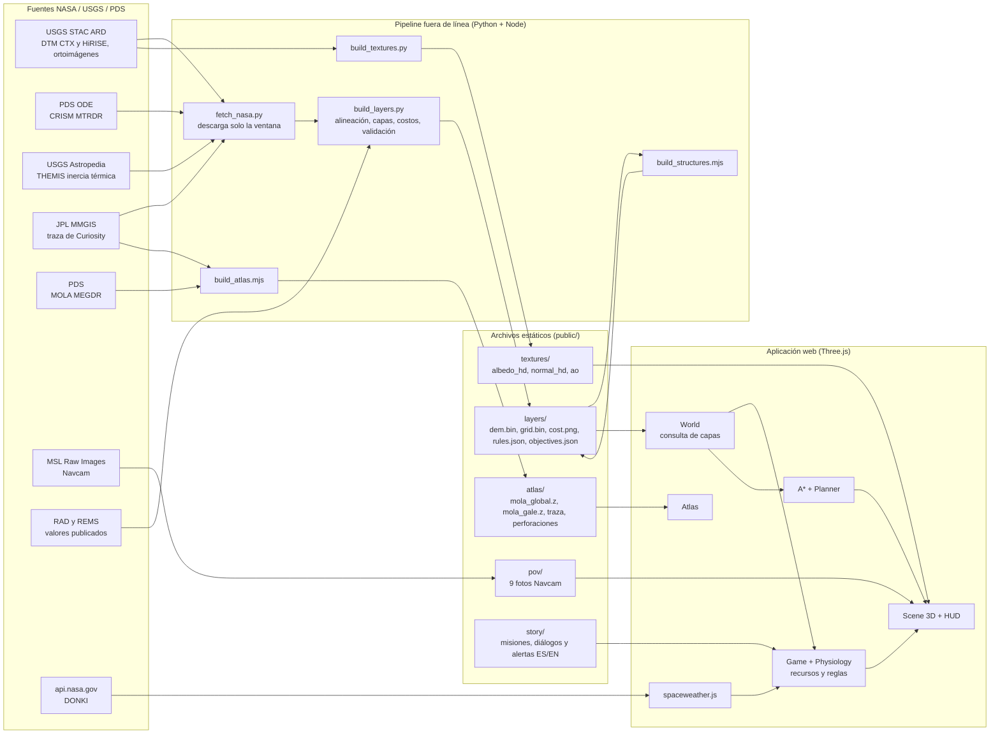

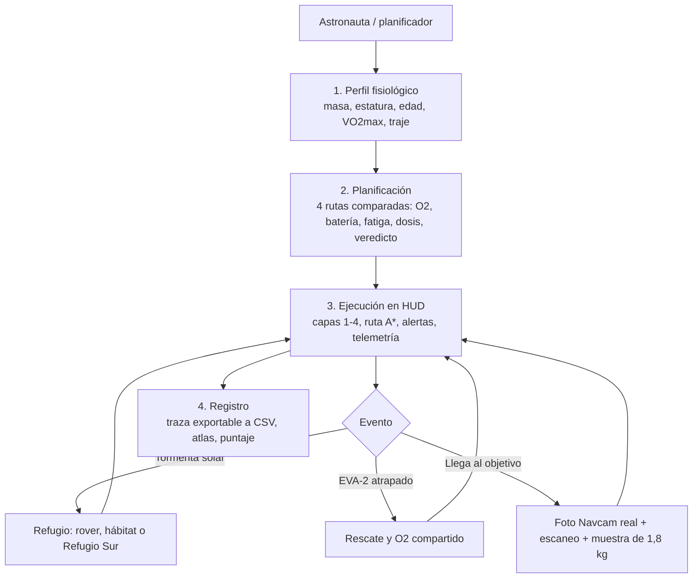

### 6.2 Capas integradas

| Capa (tecla) | Tipo de dato | Fuente | Resolución en el mapa | Regla derivada | Umbrales |
|---|---|---|---|---|---|
| Pendiente (1) | Topográfico | DTM CTX + HiRISE | 6 m | Velocidad y O₂; desgaste del traje; bloqueo | seguro < 12° · resbalón 18–25° · bloqueado > 25° |
| Rugosidad (dibujada en la 1) | Topográfico derivado | DTM HiRISE (3 m) | 6 m | Coeficiente de terreno y bloques que no se pueden pisar | rocoso > 0,6 m · campo de bloques > 0,9 m |
| Radiación (2) | Radiación | RAD + cielo visible + altura | 6 m | Pérdida de integridad del traje; ×40 en tormenta | seguro < 8,3 · peligro > 8,7 µGy/h |
| Temperatura (3) | Térmico | REMS + THEMIS + orientación | 6 m (THEMIS de 100 m remuestreado) | Consumo de batería | seguro > −25 °C · peligro < −45 °C |
| Minerales (4) | Espectral | CRISM (7 productos) | 6 m (CRISM de 18 m) | Ubicación de objetivos; coeficiente de terreno | clases 0–4 |
| Óptico / textura | Óptico | CTX 20 m + HiRISE 1 m | 1,5 m/px | Contexto visual | — |
| Ruta sugerida (R) | Combinación | `cost.png` | 12 m (A*) | Camino más seguro, no el más corto | 0 = intransitable |
| Atlas (M) | Topográfico global y atmosférico | MOLA | ~7,4 km y ~925 m | Presión, columna de aire, agua líquida | P > 611,7 Pa |
| Clima espacial | Radiación (heliofísica) | DONKI | — | Nivel de riesgo y texto del aviso | alto, moderado, bajo |

### 6.3 Resultados de validación (de `data/processed/report.json`)

| Indicador | Resultado |
|---|---|
| DEM frente a 857 paradas de Curiosity | mediana **+0,1 m**, MAD **2,17 m**, percentil 95 del error absoluto **10,85 m** |
| Pendiente en las paradas de Curiosity | mediana 8,6°, p95 **21,2°**; solo el 3,4 % cae en celdas que marcamos como bloqueadas |
| Superficie bloqueada (> 25°) | 11,6 % del recorte |
| Área alcanzable desde el hábitat | 86,1 %; **los 7 puntos clave son alcanzables** |
| Arcillas CRISM en la banda de altura de Glen Torridon | **96,1 %** |
| Sulfatos CRISM por encima de −4 078 m (unidad de sulfatos) | **96,7 %** |
| Clases minerales en el recorte | arcillas 2,7 % · sulfatos 29,1 % · arena basáltica 4,6 % |
| Inercia térmica THEMIS | 301–528 TIU (mediana 403), coherente con Fergason et al. (2012) |
| Rugosidad | 20,2 % del mapa rocoso y 8,8 % campo de bloques; solo el 12,3 % de las paradas de Curiosity están en terreno rocoso |
| Elevación del recorte | −4 330 m a −3 057 m (~1 270 m de desnivel) |
| Radiación modelada | 4,3–9,4 µGy/h (mediana 8,5) |
| Temperatura del suelo modelada | 10:00 h mediana −25 °C · noche mediana −86 °C |
| MOLA frente a Curiosity en el punto de aterrizaje | −4 505 m frente a −4 501 m |

> *Nota para la verificación del domingo:* `docs/fuentes.md` y `docs/reglas.md` citan una validación anterior (mediana −0,25 m, MAD 2,0 m). Este documento usa los valores de `report.json`, el archivo que genera el pipeline. Hay que actualizar esos dos documentos para que coincidan.

### 6.4 Objetivos científicos sobre paradas reales de Curiosity

| Punto | Tipo | Sol de Curiosity | Pendiente | Clase CRISM | Ciencia |
|---|---|---|---|---|---|
| Hábitat Aeolis | Base / refugio | 2320 | 7,1° | — | Inicio, entrada de Glen Torridon |
| Unidad de arcillas | Objetivo 1 | 2481 | 7,7° | Arcillas | Filosilicatos formados con agua de pH casi neutro (perforación *Glen Etive*) |
| Rover de apoyo Tumbo | Refugio | 3489 | 17,2° | Sulfatos | Recarga parcial (hasta 60 %) |
| Unidad de sulfatos | Objetivo 2 | 3608 | 6,2° | Sulfatos | Registro del secado del clima (perforación *Canaima*) |
| Piedras de azufre de Gediz Vallis | Objetivo 3 | 4200 | 7,7° | Sulfatos | Azufre elemental casi puro (2024) |
| Refugio Sur | Refugio / fin | 4558 | 5,5° | Boxwork | Módulo presurizado |
| Formaciones boxwork | Objetivo 4 | 4671 | 9,0° | Boxwork | Agua subterránea que cementó fracturas |

### 6.5 Funcionalidades verificadas al cierre del sábado
- `npm run build` compila sin errores (Vite 7.1.12; 33 módulos; paquete JS de 807 kB, 234 kB comprimido con gzip).
- En el servidor de desarrollo el juego carga la pantalla de perfil fisiológico con los cálculos derivados (por ejemplo, para el perfil de referencia: 504 N de peso en Marte y autonomía de O₂ de 8,0 h caminando en llano).
- **Prueba automática de principio a fin** (`docs/prueba_completa.md`): un bot juega con la misma lógica del juego, sigue el A*, escanea, se refugia en la tormenta y rescata a EVA-2.

| Perfil | Resultado | Tiempo real | Recargas | Puntos |
|---|---|---|---|---|
| Referencia (75 kg, 175 cm, VO₂max 45) | ✅ 5/5 misiones | 21,9 min | 1 | 1129 |
| 56 kg · 160 cm | ✅ | 23,4 min | 1 | 1079 |
| 92 kg · 190 cm | ✅ | 22,1 min | 1 | 1127 |
| VO₂max 28 | ✅ | 27,8 min | 1 | 1034 |
| Traje Apollo A7LB (91 kg) | ❌ sin O₂ en la misión 4 | 45,4 min | 3 | — |
| Traje xEMU (145 kg) | ❌ sin O₂ en la misión 3 | 27,4 min | 3 | — |

  Un hallazgo operacional de esta prueba: **la línea recta suele ser intransitable** (pendientes > 25°) y la ruta segura es ~18 % más larga.
- Contenido: 5 misiones, 21 alertas, diálogos y datos curiosos en ES/EN; 34 estructuras colocadas con datos (13 sitios de perforación, 6 repetidores, 5 depósitos, 3 estaciones meteorológicas, plataforma de aterrizaje, campo solar, planta ISRU de O₂, invernadero, sismómetro y Curiosity); atlas con 40 rasgos, 10 fenómenos naturales con medidas de protección, la traza completa de Curiosity y 22 perforaciones.

### 6.6 Evidencias visuales

> Capturas tomadas el 14 de noviembre de 2026 en la versión local del commit `efd3576` (Chrome, 1540×788). Para llegar rápido a cada situación se usó el modo `?debug=1` y la consola de depuración del juego (teletransporte, forzar la tormenta); todos los valores, capas, fotos y textos que se ven los calcula y muestra el propio juego.

<figure>
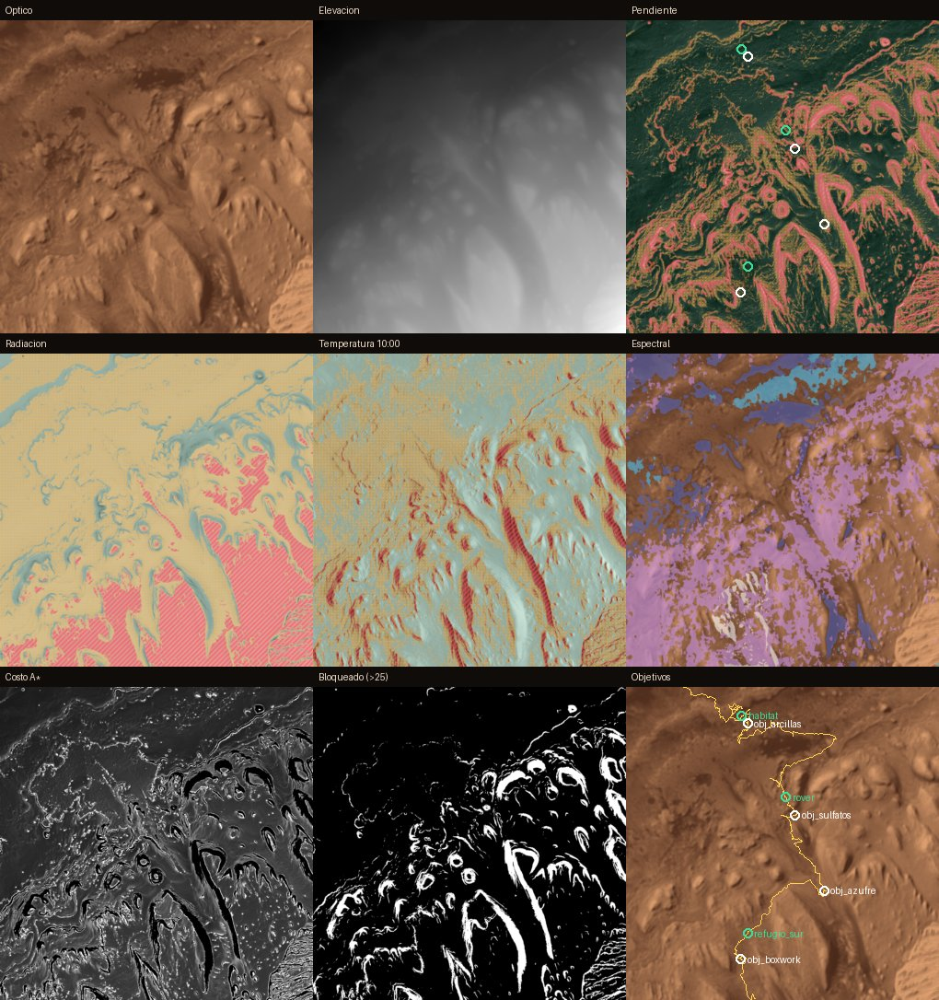
<figcaption>Figura 1. Vista previa generada por el pipeline (<code>data/processed/preview.png</code>): ortoimagen, DEM, pendiente, radiación, temperatura y minerales del recorte de 6,1 × 6,1 km.</figcaption>
</figure>


<figure>
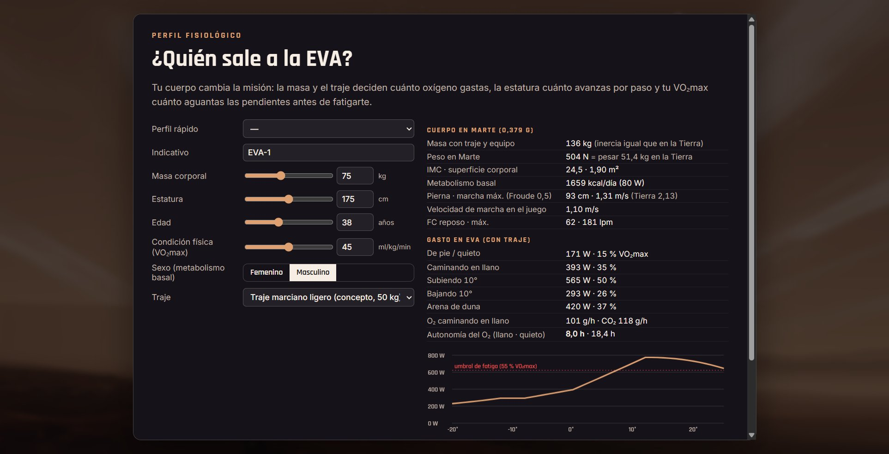
<figcaption>Figura 2. Perfil fisiológico con el astronauta de referencia (75 kg, 175 cm, VO₂max 45, traje de 50 kg): peso en Marte, metabolismo, gasto por pendiente y autonomía de O₂.</figcaption>
</figure>


<figure>
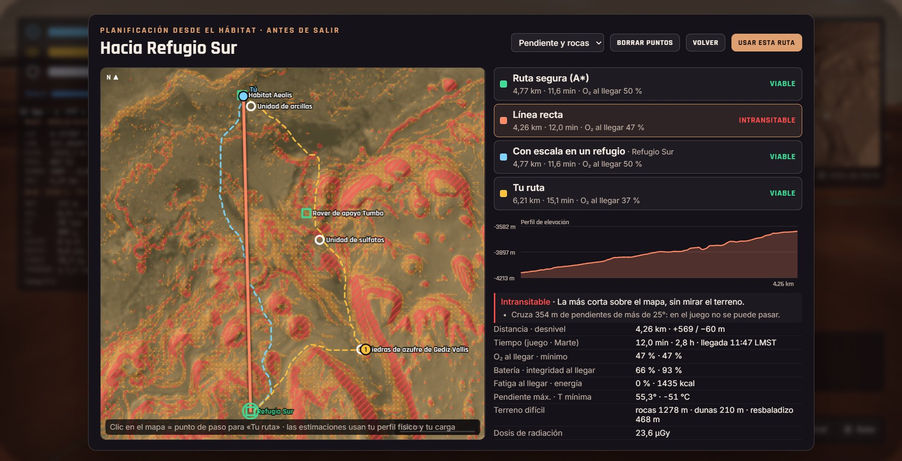
<figcaption>Figura 3. Planificación de la EVA del Hábitat Aeolis al Refugio Sur. La línea recta (seleccionada) es <strong>intransitable</strong>: cruza 354 m de pendientes &gt; 25°. La ruta A* (4,77 km, O₂ al llegar 50 %) y la ruta propia con un punto de paso en Gediz Vallis (6,21 km, 37 %) son viables.</figcaption>
</figure>


<figure>
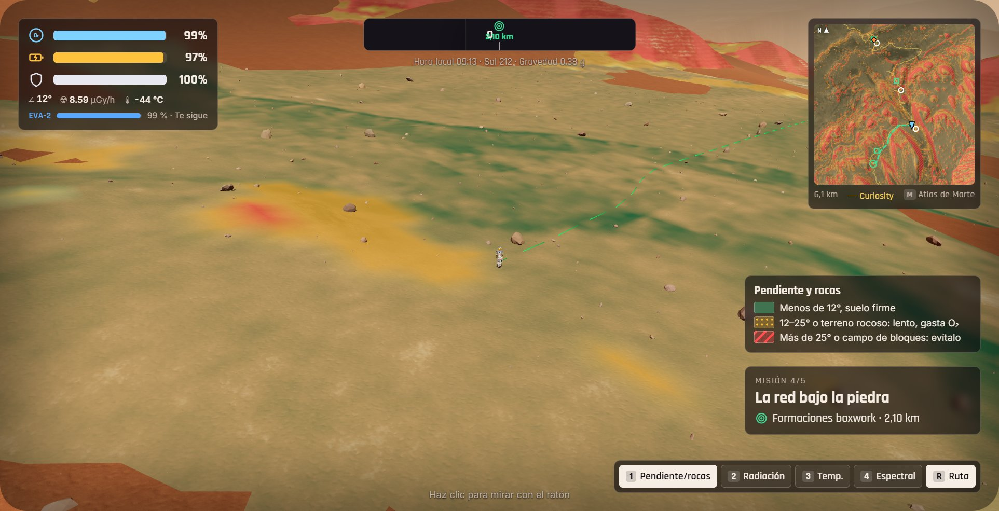
<figcaption>Figura 4. HUD sobre el terreno 3D con la capa 1 (Pendiente y rocas): verde &lt; 12°, puntos 12–25°, rayas &gt; 25°. La línea discontinua verde es la ruta A*; el minimapa muestra la traza de Curiosity.</figcaption>
</figure>


<figure>
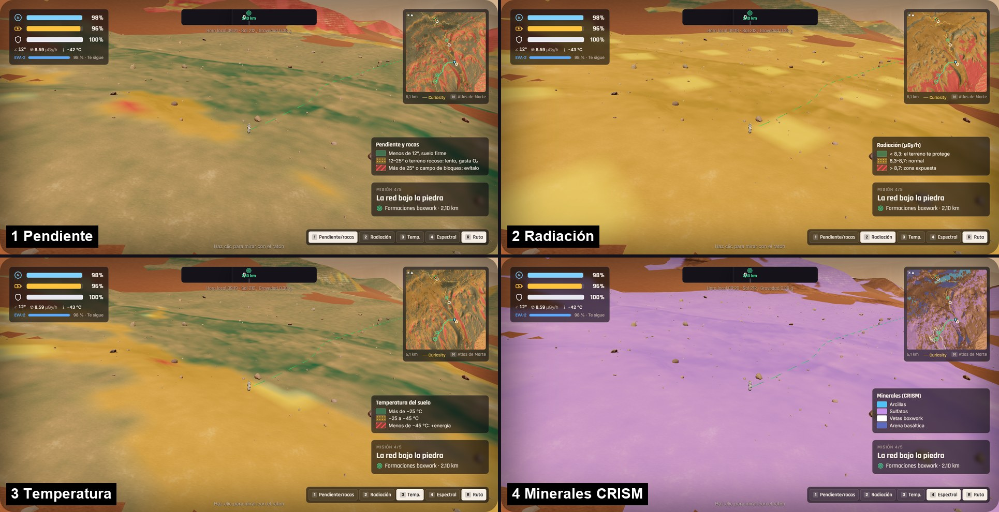
<figcaption>Figura 5. La misma vista con las cuatro capas: 1 Pendiente, 2 Radiación, 3 Temperatura y 4 Minerales CRISM (lila = sulfatos).</figcaption>
</figure>


<figure>
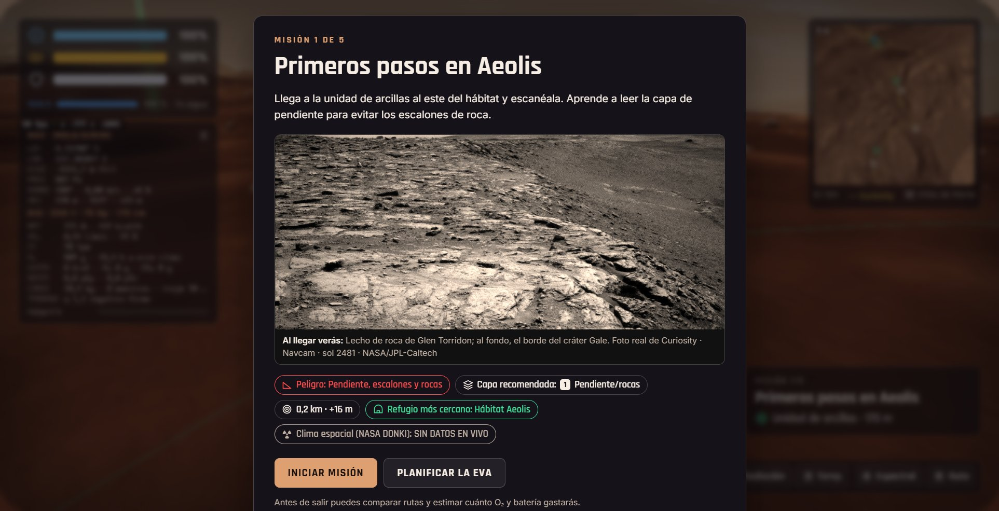
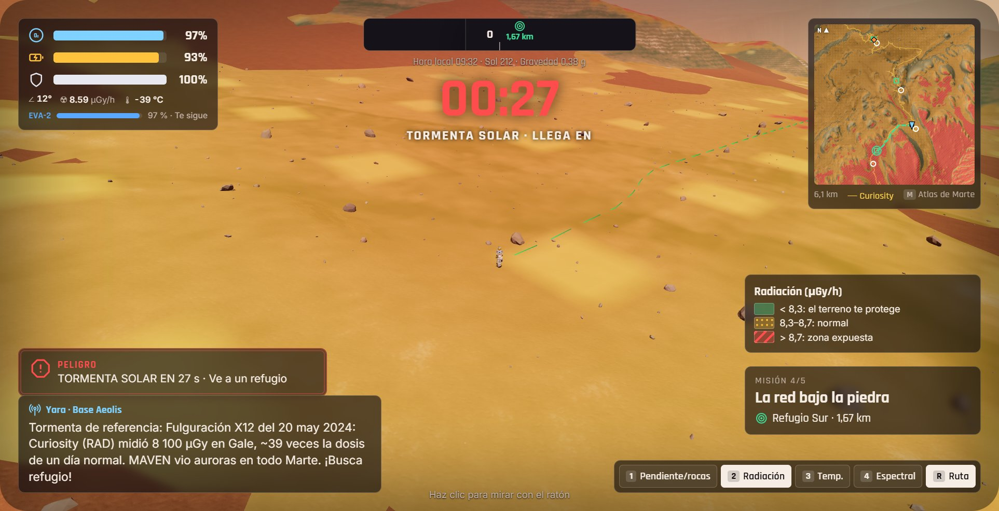
<figcaption>Figura 6. Arriba: tarjeta de misión con la foto Navcam de llegada y el chip de clima espacial NASA DONKI; durante la captura la API respondió 429 y el chip muestra «SIN DATOS EN VIVO». Abajo: alerta de tormenta solar con cuenta regresiva, capa de radiación activada y el evento de referencia real de mayo de 2024.</figcaption>
</figure>


<figure>
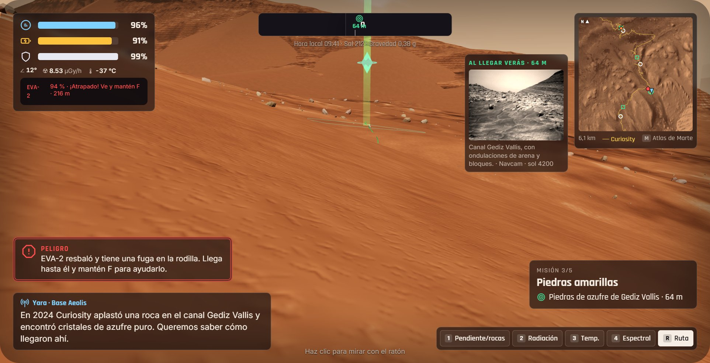
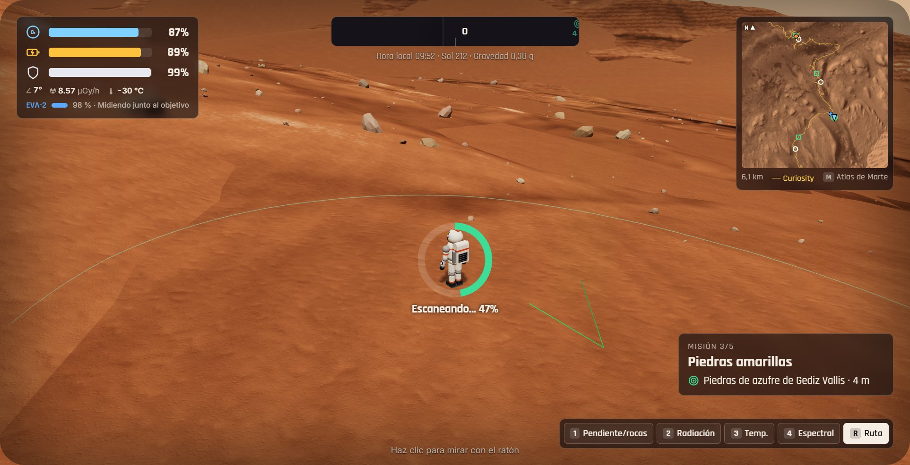
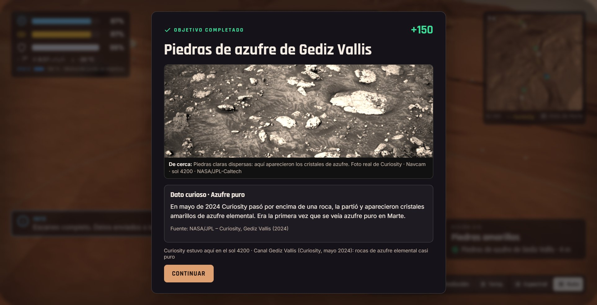
<figcaption>Figura 7. Piedras de azufre de Gediz Vallis (sol 4200): recuadro «Al llegar verás» con la foto Navcam real a 64 m, escaneo en curso dentro del radio del objetivo y tarjeta científica con la foto de cerca y la fuente NASA/JPL.</figcaption>
</figure>


<figure>
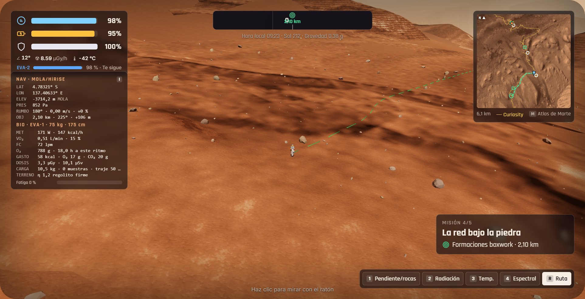
<figcaption>Figura 8. Telemetría NAV/BIO (tecla I): latitud/longitud, elevación, presión, rumbo, distancia al objetivo, potencia metabólica, VO₂, FC, O₂ restante, dosis y carga.</figcaption>
</figure>


<figure>
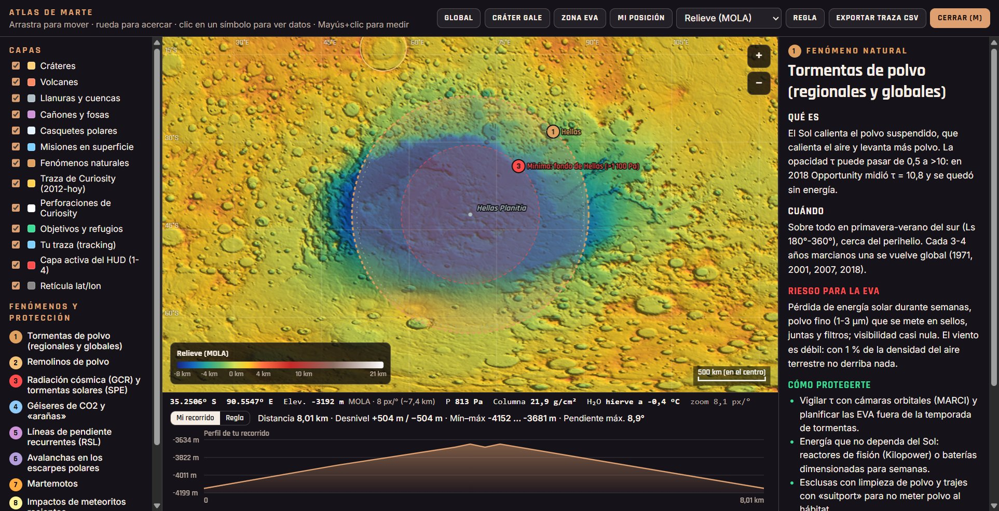
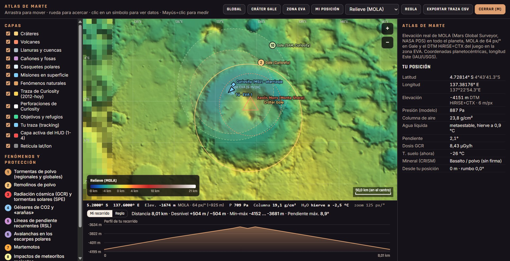
<figcaption>Figura 9. Atlas de Marte (tecla M). Arriba: nivel global con relieve MOLA y el fenómeno «Tormentas de polvo» con riesgo y medidas de protección. Abajo: nivel cráter Gale (MOLA 64 px/°) con el aterrizaje de Curiosity y la zona EVA.</figcaption>
</figure>


<figure>
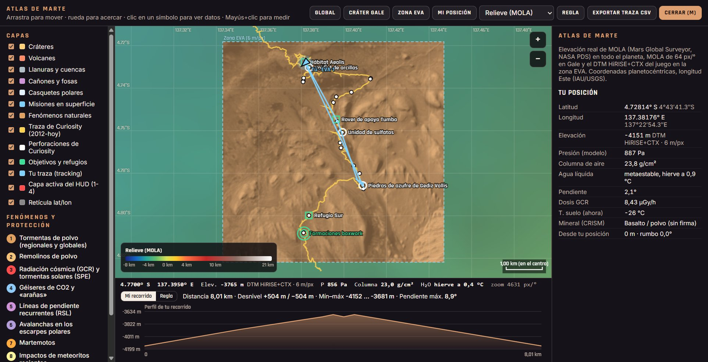
<figcaption>Figura 10. Atlas en la zona EVA (DTM HiRISE + CTX, 6 m/px) con la traza de Curiosity, objetivos, refugios, la traza propia, su perfil de elevación y el botón «Exportar traza CSV». <em>La traza propia se ve en tramos rectos porque durante la captura se usaron atajos de depuración para moverse entre objetivos.</em></figcaption>
</figure>


<figure>
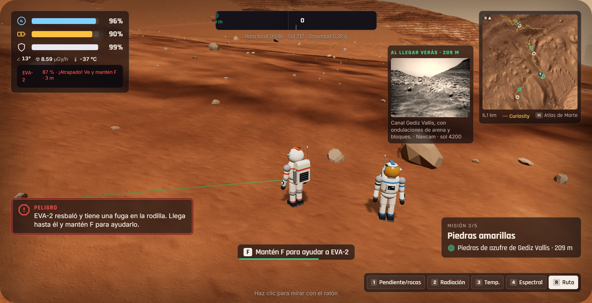
<figcaption>Figura 11. EVA-2 atrapado en Gediz Vallis: alerta de peligro, estado del compañero (O₂ 87 %) y barra de asistencia mientras se mantiene F.</figcaption>
</figure>


<figure>
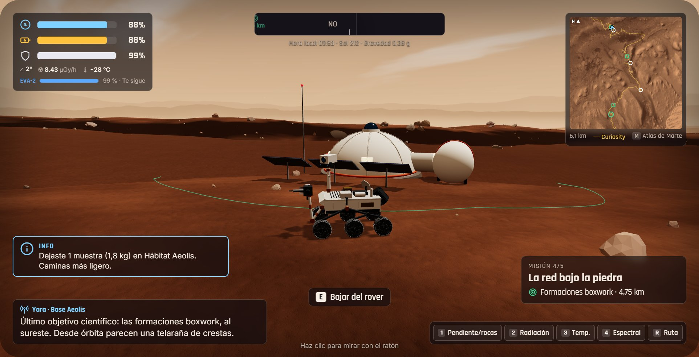
<figcaption>Figura 12. Rover de apoyo conducible (tecla E) frente al Hábitat Aeolis con el campo solar; al llegar se descargan las muestras (1,8 kg) y la carga baja.</figcaption>
</figure>


<figure>
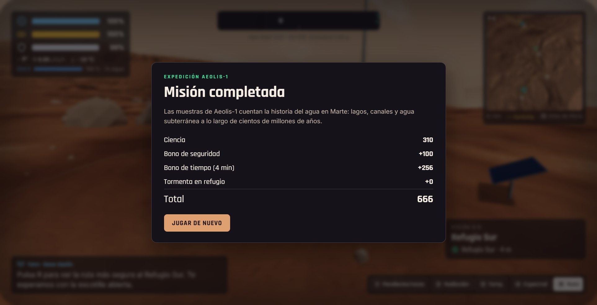
<figcaption>Figura 13. Pantalla final de la campaña con el puntaje desglosado (ciencia, seguridad, tiempo, tormenta). <em>El puntaje corresponde a la sesión de captura con atajos de depuración, no a una partida completa.</em></figcaption>
</figure>


### 6.7 Enlaces públicos

- **Demo jugable:** [COMPLETAR ENLACE PÚBLICO: Demo]
- **Repositorio GitHub:** [COMPLETAR ENLACE PÚBLICO: Repositorio GitHub — remoto actual `https://github.com/Andresmejia62/Pimpollos`; confirmar que sea público]
- **Prototipo interactivo / wireframes del HUD:** [COMPLETAR ENLACE PÚBLICO: Prototipo interactivo]
- **Video (inglés, 30 s):** [COMPLETAR ENLACE PÚBLICO: Video]

### 6.8 Cómo reproducir
```bash
cd mars-survival-map
npm install
npm run dev          # http://127.0.0.1:5173  (?debug=1 para FPS y atajos)
npm run build        # sitio estático en dist/
```
Regenerar los datos (requiere Python 3, numpy, Pillow y rasterio):
```bash
python3 data/scripts/fetch_nasa.py
python3 data/scripts/build_layers.py
python3 data/scripts/build_textures.py
node data/scripts/build_atlas.mjs
NASA_API_KEY=<clave> node data/scripts/fetch_donki.mjs
```

---

## 7. Impacto y proyección

### 7.1 Beneficiarios
**Directos**
- **Astronautas y tripulaciones de superficie:** un mapa táctico que traduce los datos en decisiones (por dónde ir, cuánto cuesta, dónde refugiarse) y que se puede consultar en el hábitat antes de salir o como HUD durante la EVA.
- **Planificadores de misión:** comparación cuantitativa de rutas según la fisiología y el traje de cada tripulante, y detección temprana de perfiles o trajes que no completan la travesía (en la prueba, los trajes pesados).
- **Investigadores planetarios:** un pipeline abierto y reproducible que alinea DTM orbitales con mediciones de un rover y produce capas validadas para cualquier recorte.

**Indirectos**
- **Educación:** el estudiante no lee que las arcillas indican agua; decide ir hasta ellas y lo comprueba. Funciona en el navegador y en español e inglés.
- **Divulgación científica:** pone en manos del público los datos de Curiosity, MRO y Odyssey en un formato que se entiende.
- **Simulación análoga:** sirve como base para ensayos de EVA en estaciones análogas y para estudiar cómo se toman decisiones con retraso de comunicación.

### 7.2 Aplicaciones en misiones tripuladas y alcance real
- **Ensayo de la travesía** antes de una EVA, con el perfil real de cada tripulante y la carga de herramientas y muestras.
- **Selección de sitios** para infraestructura: el pipeline ya coloca la plataforma de aterrizaje en el terreno más llano a menos de 170 m del hábitat y los repetidores en puntos altos.
- **Protocolos de seguridad:** refugios ante tormentas solares, *buddy system* y uso del rover como refugio móvil y transporte de muestras.
- **Escalabilidad:** el recorte se define en `region.json`; con los mismos scripts se puede generar otra zona de Marte que tenga cobertura de HiRISE, CTX y CRISM.

**Límites actuales (alcance honesto).** Es un prototipo de hackathon, no una herramienta certificada:
- La radiación y la temperatura son modelos calibrados con mediciones puntuales, no mapas medidos.
- La posición exacta de cada bloque individual es aleatoria; su abundancia sí sale del DTM.
- El modelo metabólico de Pandolf se validó en la Tierra y sus correcciones para gravedad reducida y traje son aproximadas.
- El tiempo de juego está comprimido ×14.
- No hay pruebas de usabilidad con personas todavía.

### 7.3 Hoja de ruta
**Domingo 15 de noviembre por la mañana (Bloques 05 y 06)**
1. Cambiar el título visible de la aplicación de "Mars Survival Map" a **Marsift** (`index.html`, pantalla de inicio y créditos).
2. Guardar una copia de DONKI con una clave propia de api.nasa.gov (`fetch_donki.mjs` → `public/spaceweather/donki.json`), o configurar `VITE_NASA_API_KEY` en el despliegue, para que el clima espacial muestre datos reales.
3. Igualar las cifras de validación en `docs/fuentes.md` y `docs/reglas.md` con `report.json`.
4. Publicar la demo como sitio estático y verificar los enlaces públicos.
5. Hacer las pruebas de usabilidad rápidas (`docs/pruebas_usabilidad.md`) si hay tiempo, tomar las capturas del apartado 6.6 y grabar el video de 30 s en inglés.

**Después del hackathon**
- Integrar los mapas geológicos del USGS-NASA Planetary Geologic Mapping Program y capas de JPL Mars Trek como fuentes adicionales.
- Sumar un recorte en el cráter Jezero con imágenes de Perseverance.
- Calcular sombras proyectadas y la iluminación por hora.
- Mapas de radiación con modelos de transporte de partículas.
- Modo de HUD para tablet o visor y modo multijugador para la tripulación.
- Validación del modelo fisiológico con datos de análogos de EVA.

---

## 8. Referencias y herramientas utilizadas

### 8.1 Fuentes científicas y conjuntos de datos
- USGS Astrogeology — Analysis Ready Data, catálogo STAC (DTM y ortoimágenes CTX y HiRISE): https://stac.astrogeology.usgs.gov/api
- MRO HiRISE (University of Arizona / NASA): https://www.uahirise.org
- MRO CTX (Malin Space Science Systems / NASA): https://www.msss.com/all_projects/mro-ctx.php
- PDS Geosciences Node — CRISM MTRDR y MOLA MEGDR: https://pds-geosciences.wustl.edu · ODE REST: https://oderest.rsl.wustl.edu
- THEMIS Global Thermal Inertia Mosaic (USGS/ASU): https://astrogeology.usgs.gov/search/map/themis_thermal_inertia_mosaic_quantitative_30s120e_100mpp
- NASA/JPL MMGIS — MSL waypoints: https://mars.nasa.gov/mmgis-maps/MSL/Layers/json/MSL_waypoints.json
- MSL Raw Images (Curiosity): https://mars.nasa.gov/msl/multimedia/raw-images/
- NASA DONKI (CCMC/GSFC) a través de https://api.nasa.gov
- USGS Gazetteer of Planetary Nomenclature: https://planetarynames.wr.usgs.gov
- NASA Mars Fact Sheet: https://nssdc.gsfc.nasa.gov/planetary/factsheet/marsfact.html
- Hassler, D. M. et al. (2014). Mars' surface radiation environment measured with the Mars Science Laboratory's Curiosity rover. *Science* 343, 1244797. doi:10.1126/science.1244797
- Viviano-Beck, C. E. et al. (2014). Revised CRISM spectral parameters and summary products. *JGR Planets* 119, 1403–1431.
- Fergason, R. L. et al. (2012). Surface properties of the Mars Science Laboratory candidate landing sites: Characterization from orbit and predictions. *Space Science Reviews* 170.
- Siebach, K. L. y Grotzinger, J. P. (2014). Volumetric estimates of ancient water on Mount Sharp based on boxwork deposits. *JGR Planets* 119.
- Pandolf, K. B. et al. (1977). Predicting energy expenditure with loads while standing or walking very slowly. *Journal of Applied Physiology* 43.
- Norcross, J. R. et al. (2010). *Metabolic costs and biomechanics of level ambulation in a planetary suit*. NASA/TP-2010-216139.
- Mifflin, M. D. et al. (1990); DuBois y DuBois (1916); Tanaka et al. (2001); Swain y Leutholtz (1997); Farley y McMahon (1992); Kram et al. (1997): ecuaciones del modelo fisiológico (`docs/fisiologia.md`).
- Allison, M. y McEwen, M. (2000). A post-Pathfinder evaluation of areocentric solar coordinates (algoritmo Mars24, NASA GISS).
- Standish, E. M. — *Approximate Positions of the Planets*, JPL Solar System Dynamics.
- NASA/JPL: comunicados de Curiosity sobre Glen Torridon, el azufre de Gediz Vallis (2024), la región boxwork (2025) y la tormenta solar observada en Marte en mayo de 2024.

### 8.2 Stack tecnológico detectado

| Capa | Tecnologías |
|---|---|
| Lenguajes | JavaScript (ES2022, módulos ES), Python 3, HTML5, CSS3, GLSL (*shaders* de Three.js) |
| Visualización 3D | Three.js 0.180.0 (WebGL) |
| Build y servidor de desarrollo | Vite 7.1.12, Node.js, npm |
| Procesamiento geoespacial | rasterio / GDAL (GeoTIFF optimizados para la nube, ventanas y reproyección), NumPy, Pillow |
| Protocolos de datos | STAC API, PDS ODE REST, HTTP Range (MOLA), REST (api.nasa.gov) |
| APIs del navegador | WebGL, `DecompressionStream`, Fetch, Web Audio, `localStorage` (caché de DONKI) |
| Diseño y documentación | Wireframes HTML interactivos, Markdown, Mermaid, Obsidian (notas), IDE de JetBrains (`.idea`) |
| Control de versiones | Git y GitHub |
| Publicación prevista | Sitio estático (GitHub Pages o Netlify) |

### 8.3 Declaración de uso de Inteligencia Artificial
El equipo Pimpollos declara que usó herramientas de inteligencia artificial durante el desarrollo de Marsift y la preparación de esta documentación:

- **Claude (Anthropic), incluido Claude Code:** se usó como asistente para escribir parte del código del pipeline de datos y del motor web, para redactar borradores de textos (historia, diálogos, documentación técnica) y de los wireframes, y para **auditar el repositorio y estructurar y redactar este documento** en español e inglés a partir del código, los datos y el historial reales del proyecto.
- **Otras herramientas de IA:** [COMPLETAR: listar otras herramientas de IA que haya usado el equipo, o escribir "Ninguna"].

El equipo revisó, corrigió y validó todo el contenido generado con ayuda de IA. Las cifras de este documento se tomaron de los archivos que genera el pipeline (`data/processed/report.json`, `data/raw/manifest.json`) y de la documentación técnica del repositorio. **Las imágenes, texturas y modelos de elevación del proyecto son datos reales de la NASA y del USGS, no imágenes generadas por IA.**
